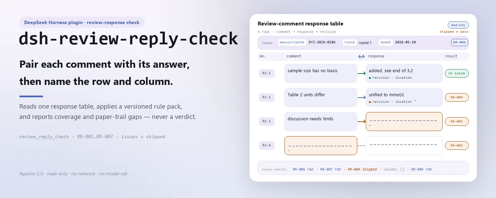
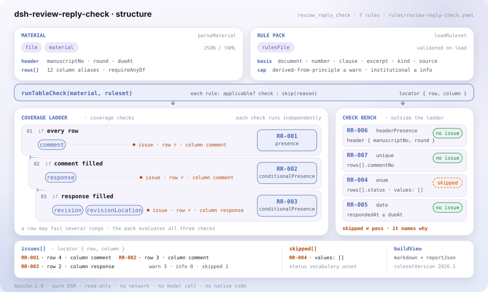

<div align="center">

<picture>
  <source media="(prefers-color-scheme: dark)" srcset="docs/assets/dsh-review-reply-check-hero-en-dark.webp">
  
</picture>

# dsh-review-reply-check

**Check every review comment gets an answer — and that the paper trail says what changed and where.**

A pure host-side checker for journal editors: it reads one review-comment response table, applies a versioned rule pack, and reports coverage and paper-trail gaps — without modifying the original, calling the network or a model, or pronouncing a verdict.

[Install](#three-step-setup) · [Configuration](#configuration) · [FAQ](#faq) · [简体中文](README.md) · [English](README.en.md)

[](LICENSE)
[](#compatibility)
[](https://www.npmjs.com/package/dsh-review-reply-check)
[](https://github.com/PerryLink/dsh-review-reply-check/actions/workflows/ci.yml)
[](#compatibility)

[](https://github.com/PerryLink/dsh-review-reply-check/stargazers)
[](https://www.npmjs.com/package/dsh-review-reply-check)
[](https://dshfind.com/plugins/PerryLink/dsh-review-reply-check?ref=badge)
[](https://securityscorecards.dev/viewer/?uri=github.com/PerryLink/dsh-review-reply-check)
[](https://dsh.market/)
[](https://gitee.com/perrylink/dsh-review-reply-check)

```sh
dsh plugin --profile <name> add dsh-review-reply-check
```

</div>

<sub>Community plugin, not affiliated with DeepSeek. Canonical repository: <https://github.com/PerryLink/dsh-review-reply-check> (Gitee is a mirror).</sub>

## What it is

`dsh-review-reply-check` reads one review-comment response table — the manuscript header plus one row per comment — and checks that table's own coverage and paper trail: that each comment's text is recorded, that every row carrying a comment also carries an author response, that a response states the revision made and where it was made, that each handling status comes from the vocabulary you configure, that response dates fall inside the revision deadline the table itself states, that the table header declares its manuscript and review round, and that comment numbers are not repeated.

It registers the `review_reply_check` tool and returns findings with a `locator` under a versioned rule pack; checks that cannot run are written into `skipped` with a reason, never passed silently. Pure host side: the original is never modified, nothing is sent over the network, no model is called, and the plugin never decides whether a response is adequate, whether the revision is sufficient, or whether the manuscript should be accepted.

<picture>
  <source media="(prefers-color-scheme: dark)" srcset="docs/assets/dsh-review-reply-check-flow-v5-dark.svg">
  
</picture>

## Three-step setup

1. **Install** (pick one channel):

   ```sh
   # git channel (latest main; equivalent to git+https://github.com/PerryLink/dsh-review-reply-check.git)
   dsh plugin --profile web add github:PerryLink/dsh-review-reply-check
   # npm channel (published releases)
   dsh plugin --profile web add dsh-review-reply-check
   # tarball channel: pnpm pack in this repo, then
   dsh plugin --profile web add ./dsh-review-reply-check-<version>.tgz
   ```

   The published package ships `lib/`, `rules/`, `locale/` and `cordis.patch.yml`, so installation is all that is needed.

2. **Minimal config** (sane defaults; change only the keys you need):

   ```yaml
   - insert:
       - id: dsh-review-reply-check
         name: dsh-review-reply-check
         config:
           rulesFile: rules/review-reply-check.yaml
   ```

3. **Verify it mounts**:

   ```sh
   dsh --profile web --dump-config | grep 'dsh-review-reply-check'
   ```

   Run the bundled sample from the repository (build first):

   ```sh
   pnpm install && pnpm run build
   node samples/quickstart/run.mjs --check
   ```

   ```
   review_reply_check: 1 issue(s) — error 0, warn 1, info 0
   skipped: 2
   ```

   The sample lives in `samples/quickstart/input/`, the expected output in `samples/quickstart/expected/result.json`, and the screenshot in `docs/assets/quickstart.png`.

**Uninstall**: `dsh plugin --profile web remove dsh-review-reply-check` (or remove the row from the profile patch).

## Core capabilities

`review_reply_check` does one thing: it compares the material against the rule pack and returns locatable differences. It accepts `file` or `material` (JSON / YAML), plus the optional `rulesFile` and `only`.

| Rule | What it checks | Severity | Basis kind |
|---|---|---|---|
| `RR-001` | the comment text is recorded | warn | principle |
| `RR-002` | every comment carries a response | warn | principle |
| `RR-003` | a response states the revision and its location | warn | principle |
| `RR-004` | the status comes from your vocabulary (off by default) | info | local |
| `RR-005` | the response date falls inside the recorded deadline | info | local |
| `RR-006` | the sheet names its manuscript and round | warn | principle |
| `RR-007` | comment numbers are unique | warn | principle |

The rule pack is data, not code: replacing `rules/*.yaml` switches the rule set without touching TypeScript. On load every rule is validated for `document` / `number` / `clause` / `excerpt` / `kind` / `source`, and severity is capped by the basis — a principle-derived rule can go no higher than `warn`, an institutional-configuration rule no higher than `info`. An empty issue list can never be read as "nothing is wrong": every check that could not run is written into `skipped`.

## What it answers

The table below is the example set: the first row is the detailed walkthrough, the remaining rows are short cases.

This is the plugin's real output on its own `RR-001` test fixture, not a mock-up. The rule pack does not invent citations, so every finding names the clause it applies and states that the clause text was not obtained.

### Detailed output

**Tool** `review_reply_check`

**Input**

~~~json
{"manuscriptNo":"XYZ-2026-0186","title":"某某研究","rows":[{"序号":"R1-1","审稿人":"审稿人一","审稿意见":"","处理状态":"已修改"}]}
~~~

**Output**

~~~json
{
  "id": "dsh-review-reply-check.RR-001.de09b5a6",
  "ruleId": "RR-001",
  "severity": "warn",
  "locator": {
    "row": 1,
    "field": "comment"
  },
  "found": "第 1 行「comment」为空",
  "expected": "「comment」应填写",
  "fix": "补填审稿意见内容；本条只核对是否填写"
}
~~~

*Observed from `dsh-review-reply-check/tests/fixtures/RR-001/RR-001-unsafe.json (cases.json expects 1×RR-001); executed parseMaterial+runCheck, checkedAt=2026-10-06T00:00:00.000Z`*

| You ask | What it answers |
|---|---|
| A row carries an author response but the cell holding the comment text is empty. | `RR-001` requires the comment text on every row: without it the response has no object, and the editor cannot see which comment it answers. The rule checks only that the cell is filled — it does not judge whether the comment holds or whether it is a matter of academic disagreement. |
| A comment is recorded but the author response cell is still empty — is that reported? | Yes. `RR-002` requires a response on every row whose comment cell is filled, because a comment passed over in silence is not the same as a disagreement a reviewer can weigh. It checks only that the response cell is filled, not whether the response is adequate or convincing; when a comment genuinely needs no change, the pack advises writing the reason in that cell rather than leaving it blank. |
| The response says the text was revised, but the revision note and the location column are blank. | `RR-003` requires both `revision` and `revisionLocation` on every row whose `response` is filled. It checks that the two cells are written, not that the change is where they say it is — the plugin never sees the manuscript, so a precisely located revision note describing a change that was never made still passes. |
| Every row has a handling status filled in. How does the tool decide whether the value is acceptable? | `RR-004` compares the value in the `status` column against the list you configure. That list ships empty, meaning not configured, so until you fill it in the rule reports itself in `skipped` rather than passing silently. It checks only that the value is on your list; it does not decide whether a given status means the comment was properly handled. As an institutional-configuration rule it is capped at `info`. |
| The response date is later than the deadline column — does that mean the revision was overdue? | `RR-005` compares `respondedAt` against the `dueAt` the table itself writes, and a hit means only that the two disagree with the deadline you recorded — not that the revision was late, since periods differ by journal and authors may ask for extensions. No number of days is built in and nothing is inferred for you: when `dueAt` is empty the rule reports itself in `skipped` instead of assuming a deadline. |
| Two reviewers' comments were merged into one sheet and both number from 1, so a comment number appears twice. | `RR-007` reports a repeated value in `commentNo`, because a duplicate makes the coverage count wrong and breaks the correspondence with the review form. Registering merged comments under a numbering that carries the reviewer — `R1-3`, `R2-1` — keeps them unique; the rule compares the numbers as written and does not merge or renumber anything. |

## Standards it follows

| Document | Number | Cited by rules |
|---|---|---|
| Chinese University Sci-Tech Journal Editing Standard | Current version and clause number not verified this time | RR-001, RR-002, RR-003, RR-006, RR-007 |
| This journal's peer-review and revision rules (institutional configuration) | No uniform standard (this rule rests on the institution's status vocabulary) | RR-004 |
| This journal's peer-review and revision rules (institutional configuration) | No uniform standard (this rule rests on the deadline recorded in the register) | RR-005 |

The rule pack does not invent citations: this verification pass did not obtain the verbatim clause text, so every rule's `excerpt` states that gap and its severity is capped at `warn` or `info`.

## Configuration

All tunables are Schemastery `Config` fields in `src/config.ts`, changeable from `cordis.yml` without editing code; per-rule thresholds live in the rule pack under `rules/`. An id-targeted override replaces the whole row — restate every key you need.

| Key | Type | Default | Description |
|---|---|---|---|
| `rulesFile` | string | `rules/review-reply-check.yaml` | Rule-pack path, relative to the package root |
| `disabledRules` | string[] | `[]` | Rule ids to stop running; each appears in `skipped` |
| `onlyRules` | string[] | `[]` | Run only these rule ids; empty runs every rule |
| `skipNotes` | string | `""` | Note appended to every `skipped` reason |
| `timeoutMs` | number | `120000` | Cooperative tool timeout budget |

<details>
<summary>Rule-level parameters</summary>

- `RR-004` `values` — your status vocabulary, e.g. `[revised, partially revised, not revised with reasons, removed]`. Empty means no check.
- `RR-005` reads the register's revision-deadline / `dueAt` column. The plugin never derives a deadline from a day count.
- `RR-002` and `RR-003` use `conditionField` / `requiredFields` — what triggers each requirement.
- `RR-007` keys on the comment-number column. When several reviewers' comments are merged, number them per reviewer (`R1-3`, `R2-1`) so the rule can tell them apart.

</details>

Example override in your profile patch:

```yaml
- insert:
    - id: dsh-review-reply-check
      name: dsh-review-reply-check
      config:
        rulesFile: rules/review-reply-check.yaml
        onlyRules: [RR-001, RR-002, RR-003, RR-006, RR-007]
        timeoutMs: 120000
```

## Material format

The tool accepts JSON or YAML:

```yaml
manuscriptNo: XYZ-2026-0186
title: 某某研究
journal: 某某学报
round: 第 1 轮
dueAt: 2026-05-10
rows:
  - { 序号: R1-1, 审稿人: 审稿人一, 意见类型: 方法, 指向位置: 第 3 节 3.2,
      审稿意见: 3.2 节的样本量未说明估算依据，请补充。,
      作者回应: 同意补充。已在 3.2 节末增加样本量估算说明，并引用既往研究作为依据。,
      修改说明: 新增一段样本量估算依据，引用两项既往研究并给出效应量假设。,
      修改位置: 第 8 页第 12—18 行（修订稿 3.2 节末）,
      处理状态: 已修改, 回应人: 通讯作者, 回应日期: 2026-05-06 }
```

Column names are matched case-insensitively and ignoring spaces, underscores and hyphens; the table's own column names are kept, so a finding names the column it read. Fields are optional at the reader layer and validated by the check engine, so a partial export produces "missing item" findings instead of crashing.

## Rule sources

Rule data lives in `rules/review-reply-check.yaml`. The pack's header states the citation gap in full, and each rule's `note` repeats the part that matters for that rule. The load-time guard that normally enforces "an excerpt must be a real quotation of at least eight characters" cannot tell a quotation from a description — so this pack leans on the header, the per-rule notes and a test that asserts every `excerpt` admits the gap.

The verified boundaries and the conclusions deliberately **not** drawn are in `rules/evidence/`. **When the texts are in hand, replace each `excerpt` with the real clause and raise `kind` to `direct`.**

## FAQ

<details>
<summary>Does the material reach a model or the network? Where is data stored?</summary>

No. The checker is read-only and host-side: material enters through `file` or `material`, is parsed in memory and handed to `runCheck`; nothing is written back, no temporary files are created, no network request is made and no model is called — that is what "no network, no model call" in Compatibility means. The report goes back to the current session only.

</details>

<details>
<summary>Does an empty issue list mean the material is fine?</summary>

No. Every check that could not run goes into `skipped` with a reason; the rule pack's redline is that an empty issue list can never be read as "nothing is wrong". Read `issueCount`, `skippedCount` and `summary` together.

</details>

<details>
<summary>Why does `RR-004` never run?</summary>

Its `values` list ships empty, meaning not configured, so the rule reports itself in `skipped` rather than passing silently. It runs only after you fill in this journal's status vocabulary; even then it checks membership in your list, not whether a status means the comment was properly handled.

</details>

<details>
<summary>Why is `RR-005` reported in `skipped`?</summary>

The register records no revision deadline (`dueAt` is empty). No number of days is built in and no deadline is inferred; the rule compares response dates only when the register states the deadline itself. A hit means "this disagrees with the deadline you recorded", never "you were late".

</details>

<details>
<summary>How big is the overhead? Does it collide with other plugins?</summary>

The check is a pure function: no network, no model call, reading the material and rule pack in memory with no extra I/O. The plugin registers exactly one tool, `review_reply_check`; it provides no service key, registers no client slot and no `webServer` prefix, and mutates no globals.

</details>

## Security boundaries

- **Read-only material.** `file` or `material` is parsed in memory; the plugin never rewrites the material, writes no temporary files, and the `target` in a report is only the read location.
- **No verdict.** It lists literal differences against the cited clauses and leaves the decision to the editor; a wording guard and a disclaimer on every report enforce that.
- **It never sees the manuscript.** `RR-003` checks that the revision note and location are written, never that the change exists.
- **No built-in deadline or status vocabulary.** `RR-005` compares only against the register's `dueAt`; `RR-004`'s `values` ship empty.
- **No fabricated citations.** Every `excerpt` says in so many words that the clause text was not obtained; load-time validation refuses a severity above the basis cap.
- **Fail closed.** Empty or malformed material raises `MaterialError`; the plugin never emits an empty report that could pose as a pass.

**Boundary:** this plugin checks a **review-comment response table** for coverage and evidence — that every comment is recorded, that every comment carries an author response, that a response states the revision made and where it was made, that the handling status comes from your vocabulary, that response dates fall inside the revision deadline the register states, that the sheet names its manuscript and review round, and that comment numbers are unique. It does **not** decide whether a response is adequate, whether the revision is sufficient, or whether the manuscript should be accepted.

### ⚠️ What this plugin can and cannot see

> **It never sees the manuscript.** It can check that a response says *where* a change was made — never that the change is there, and never that it addresses the comment. `RR-003`'s note and the troubleshooting section say so: a confident, well-located, entirely fictional revision note passes this plugin.
>
> The relation between "no response" and "disagreement" is the point of `RR-002`: a reviewer can accept an author's disagreement but not a comment passed over in silence, so **coverage** is the most direct indicator of revision quality. The rule therefore fires on an empty response cell — and its note advises recording the reason rather than leaving the cell blank when a comment genuinely needs no change.
>
> **No revision deadline is built in.** Periods differ by journal and authors may ask for extensions, so `RR-005` compares the response date against the **deadline written in the register**, and reports itself in `skipped` when that column is empty. A finding means "this disagrees with the deadline you recorded", never "you were late". The status vocabulary ships **empty** for the same reason.
>
> **Every `excerpt` in the rule pack says, in so many words, that the clause text was not obtained.** The regime lives in GB/T 7713.1, the Chinese university journal editing standard, and each journal's peer-review rules. The verification pass could not retrieve verbatim clause text, so the pack states the gap in the `excerpt` field itself and keeps every rule at `warn` or `info`. **When the texts are in hand, replace each `excerpt` with the real clause and raise `kind` to `direct`.**

## Known limitations

- **It never sees the manuscript.** `RR-003` checks that the revision note and location are written, not that the change exists; a precisely located revision note describing a change that was never made still passes.
- **No revision deadline is built in.** `RR-005` compares only against the register's own `dueAt`; when that column is empty it reports `skipped` and assumes no deadline, and it never derives a day count for you.
- **The status vocabulary ships empty.** `RR-004` reports `skipped` rather than passing silently until `values` is configured; even then it checks membership only.
- **Citation gap.** This verification pass did not obtain verbatim clause text, so every rule is `derived-from-principle` or `institutional-configuration`, with severity capped at `warn` / `info`.
- **No timezone conversion.** All arithmetic is wall-clock arithmetic on the input strings; if a time looks shifted, check how the date is written in the material.

## Troubleshooting

- **`RR-003` passed a revision note describing a change that was never made.** It checks that a location is *stated*, never that the change is there. Comparing needs the manuscript, which the plugin does not see.
- **`RR-002` fires on a comment I chose not to act on.** Record the reason in the response cell. A reviewer can accept a reasoned disagreement; a blank cell reads as "not addressed".
- **`RR-005` reports itself as skipped.** The register records no revision deadline, and the plugin will not invent one.
- **`RR-004` never runs.** Its vocabulary is empty; fill it with your journal's statuses.
- **`RR-007` fires on comments from different reviewers.** Number them per reviewer so the merged table stays unambiguous.
- **A rule did not run.** Read the `skipped` array; it names the rule id and the reason.
- **The plugin installs but the tool never appears.** Check that `main` resolves to `lib/index.mjs` and that `pnpm run build` produced it; a wrong `main` makes the loader skip the entry silently.
- **`dsh plugin add` refuses the package as incompatible.** The peer range covers `0.1.x` and `0.2.x`; if your runtime sits outside it, grant an explicit exemption: `dsh plugin --profile <name> allow-version dsh-review-reply-check@0.1.0 --dsh-version <runtime> --accept-risk`
- **`check` reports `manifest-peers` as failed.** The static checker compares against a hard-coded peer range that predates the 0.2 line. The runtime enforces peer compatibility at install time, so the declared range is the correct one; this is a known upstream issue in `dsh-plugin-dev`.
- **Times look shifted.** All arithmetic is wall-clock arithmetic on the input strings; no timezone conversion is performed.

## Compatibility

| Surface | Status |
|---|---|
| Harness | Peer range `>=0.1.2-rc.1 <0.2.0 \|\| >=0.2.0-0 <0.3.0` — verified to accept both `0.2.0-rc.2` and `0.2.1-rc.2`. `engines.dsh` is declared as `>=0.2.1-0 <0.3.0` and is enforced by the host since 0.2.1 |
| Node | `^22.19.0 || >=24.0.0` |
| Platforms | All (plain ESM; no native code, no network, no model call) |
| Tool mode | Works in `native` and `ptc`; for a full directory use `ptc` |

## Ecosystem & quality

- [Gitee mirror](https://gitee.com/perrylink/dsh-review-reply-check) (sync mirror; GitHub is canonical)
- [dshfind plugin page](https://dshfind.com/plugins/PerryLink/dsh-review-reply-check) (installs and ranking)
- [OpenSSF Scorecard report](https://securityscorecards.dev/viewer/?uri=github.com/PerryLink/dsh-review-reply-check) (driven by [.github/workflows/scorecard.yml](.github/workflows/scorecard.yml))
- [DSH Market](https://dsh.market/) (listed)
- [Ecosystem knowledge base](https://perrylink.github.io/dsh-plugin-guide/) — measured data, not marketing: plugin development guide · plugin-selection data · maintenance criteria
- [Choose a checker by material](https://perrylink.github.io/zh/checkers/choose/) (family index)

## Development

```sh
pnpm install
pnpm run typecheck        # tsc --noEmit
pnpm test                 # vitest: shared table-plugin suite plus paired fixtures
pnpm run build            # tsdown -> lib/index.mjs + lib/index.d.mts
pnpm run verify:self-contained
pnpm run check:lockfile
pnpm run check:readmes    # README consistency
pnpm run check:citations
node ../scripts/sync-shared.mjs dsh-review-reply-check   # refresh src/shared from ../_shared
pnpm pack
```

The plugin is **data-only**: `src/model.ts` declares the table shape, the shared kit supplies the reader and the check engine, and the rule pack declares every check. `src/shared/` is copied in from `../_shared`, not imported — re-run the sync command above after every shared change.

The README images are generated programmatically by [`scripts/gen-readme-assets.py`](scripts/gen-readme-assets.py) (Python + Pillow) and are safe to re-run: `python scripts/gen-readme-assets.py`.

## Family & thanks

This project is part of the DeepSeek Harness plugin family from [PerryLink](https://github.com/PerryLink) (all Apache-2.0). If it is useful, **a star helps the next person find it** — nothing is gated behind it.

- [@PerryLink](https://github.com/PerryLink) — creator and maintainer: the review-reply coverage rule pack, the `review_reply_check` tool, and the five-language docs.

<details>
<summary>Expand all plugins</summary>

| Plugin | Status |
|---|---|
| **[dsh-aqua-input-check](https://github.com/PerryLink/dsh-aqua-input-check)** |  |
| **[dsh-archive-check](https://github.com/PerryLink/dsh-archive-check)** |  |
| **[dsh-auto-review](https://github.com/PerryLink/dsh-auto-review)** |  |
| **[dsh-autotier](https://github.com/PerryLink/dsh-autotier)** | 🧊 FROZEN — see the repo README |
| **[dsh-bid-ca-precheck](https://github.com/PerryLink/dsh-bid-ca-precheck)** |  |
| **[dsh-bid-qual-check](https://github.com/PerryLink/dsh-bid-qual-check)** |  |
| **[dsh-cert-mcp](https://github.com/PerryLink/dsh-cert-mcp)** | 🧊 FROZEN — see the repo README |
| **[dsh-checkpoint-rewind](https://github.com/PerryLink/dsh-checkpoint-rewind)** |  |
| **[dsh-click](https://github.com/PerryLink/dsh-click)** |  |
| **[dsh-composer-history](https://github.com/PerryLink/dsh-composer-history)** |  |
| **[dsh-contract-stance](https://github.com/PerryLink/dsh-contract-stance)** |  |
| **[dsh-customs-doc-check](https://github.com/PerryLink/dsh-customs-doc-check)** |  |
| **[dsh-data-quality](https://github.com/PerryLink/dsh-data-quality)** | 🧊 FROZEN — see the repo README |
| **[dsh-demurrage-ledger](https://github.com/PerryLink/dsh-demurrage-ledger)** |  |
| **[dsh-doublecheck](https://github.com/PerryLink/dsh-doublecheck)** |  |
| **[dsh-drill-script-check](https://github.com/PerryLink/dsh-drill-script-check)** |  |
| **[dsh-eia-guide-check](https://github.com/PerryLink/dsh-eia-guide-check)** |  |
| **[dsh-emergency-plan](https://github.com/PerryLink/dsh-emergency-plan)** |  |
| **[dsh-essay-rubric-check](https://github.com/PerryLink/dsh-essay-rubric-check)** |  |
| **[dsh-evidence-check](https://github.com/PerryLink/dsh-evidence-check)** |  |
| **[dsh-export-ctl-check](https://github.com/PerryLink/dsh-export-ctl-check)** |  |
| **[dsh-fast](https://github.com/PerryLink/dsh-fast)** |  |
| **[dsh-fmea-table-check](https://github.com/PerryLink/dsh-fmea-table-check)** |  |
| **[dsh-forecast-penalty](https://github.com/PerryLink/dsh-forecast-penalty)** |  |
| **[dsh-fund-research](https://github.com/PerryLink/dsh-fund-research)** |  |
| **[dsh-github](https://github.com/PerryLink/dsh-github)** |  |
| **[dsh-gongwen-flow-check](https://github.com/PerryLink/dsh-gongwen-flow-check)** |  |
| **[dsh-gongwen-word-check](https://github.com/PerryLink/dsh-gongwen-word-check)** |  |
| **[dsh-guard-plan-qc](https://github.com/PerryLink/dsh-guard-plan-qc)** |  |
| **[dsh-hazchem-check](https://github.com/PerryLink/dsh-hazchem-check)** |  |
| **[dsh-hazplan-check](https://github.com/PerryLink/dsh-hazplan-check)** |  |
| **[dsh-hidden-risk-map](https://github.com/PerryLink/dsh-hidden-risk-map)** |  |
| **[dsh-hs-classify](https://github.com/PerryLink/dsh-hs-classify)** |  |
| **[dsh-icd-rule-check](https://github.com/PerryLink/dsh-icd-rule-check)** |  |
| **[dsh-industry-research](https://github.com/PerryLink/dsh-industry-research)** |  |
| **[dsh-lawcite-adapter](https://github.com/PerryLink/dsh-lawcite-adapter)** |  |
| **[dsh-laya](https://github.com/PerryLink/dsh-laya)** |  |
| **[dsh-lc-doc-check](https://github.com/PerryLink/dsh-lc-doc-check)** |  |
| **[dsh-learning-gap-check](https://github.com/PerryLink/dsh-learning-gap-check)** |  |
| **[dsh-library](https://github.com/PerryLink/dsh-library)** |  |
| **[dsh-local-ai](https://github.com/PerryLink/dsh-local-ai)** |  |
| **[dsh-lsp-actions](https://github.com/PerryLink/dsh-lsp-actions)** |  |
| **[dsh-mask](https://github.com/PerryLink/dsh-mask)** |  |
| **[dsh-mcp-panel](https://github.com/PerryLink/dsh-mcp-panel)** |  |
| **[dsh-medrec-qc](https://github.com/PerryLink/dsh-medrec-qc)** |  |
| **[dsh-memento](https://github.com/PerryLink/dsh-memento)** | 🧊 FROZEN — see the repo README |
| **[dsh-nsfc-form-check](https://github.com/PerryLink/dsh-nsfc-form-check)** |  |
| **[dsh-nurse-record-check](https://github.com/PerryLink/dsh-nurse-record-check)** |  |
| **[dsh-observe](https://github.com/PerryLink/dsh-observe)** |  |
| **[dsh-origin-rvc-check](https://github.com/PerryLink/dsh-origin-rvc-check)** |  |
| **[dsh-ota-review-check](https://github.com/PerryLink/dsh-ota-review-check)** |  |
| **[dsh-output-styles](https://github.com/PerryLink/dsh-output-styles)** |  |
| **[dsh-paper-doc-adapter](https://github.com/PerryLink/dsh-paper-doc-adapter)** |  |
| **[dsh-permission-rules](https://github.com/PerryLink/dsh-permission-rules)** |  |
| **[dsh-permit-report-check](https://github.com/PerryLink/dsh-permit-report-check)** |  |
| **[dsh-pipeline-check](https://github.com/PerryLink/dsh-pipeline-check)** |  |
| **[dsh-pleading-draft](https://github.com/PerryLink/dsh-pleading-draft)** |  |
| **[dsh-plugin-doctor](https://github.com/PerryLink/dsh-plugin-doctor)** | 🚫 RETIRED (repo archived) |
| **[dsh-plugin-guide](https://github.com/PerryLink/dsh-plugin-guide)** |  |
| **[dsh-plugin-kit](https://github.com/PerryLink/dsh-plugin-kit)** | 🚫 RETIRED (repo archived) |
| **[dsh-plugin-upgrade](https://github.com/PerryLink/dsh-plugin-upgrade)** | 🚫 RETIRED (repo archived) |
| **[dsh-policy-brief-draft](https://github.com/PerryLink/dsh-policy-brief-draft)** |  |
| **[dsh-power-loss-split](https://github.com/PerryLink/dsh-power-loss-split)** |  |
| **[dsh-power-ticket-check](https://github.com/PerryLink/dsh-power-ticket-check)** |  |
| **[dsh-ppap-check](https://github.com/PerryLink/dsh-ppap-check)** |  |
| **[dsh-protest-deadline](https://github.com/PerryLink/dsh-protest-deadline)** |  |
| **[dsh-railway-window](https://github.com/PerryLink/dsh-railway-window)** |  |
| **[dsh-repair-order-qc](https://github.com/PerryLink/dsh-repair-order-qc)** |  |
| **[dsh-research-report](https://github.com/PerryLink/dsh-research-report)** |  |
| **[dsh-review-reply-check](https://github.com/PerryLink/dsh-review-reply-check)** |  |
| **[dsh-rulefile-check](https://github.com/PerryLink/dsh-rulefile-check)** |  |
| **[dsh-safety-brief-check](https://github.com/PerryLink/dsh-safety-brief-check)** |  |
| **[dsh-score](https://github.com/PerryLink/dsh-score)** | 🧊 FROZEN — see the repo README |
| **[dsh-session-sync](https://github.com/PerryLink/dsh-session-sync)** |  |
| **[dsh-site-log-check](https://github.com/PerryLink/dsh-site-log-check)** |  |
| **[dsh-skill-pack-security](https://github.com/PerryLink/dsh-skill-pack-security)** |  |
| **[dsh-soe-decision-check](https://github.com/PerryLink/dsh-soe-decision-check)** |  |
| **[dsh-soilwater-check](https://github.com/PerryLink/dsh-soilwater-check)** |  |
| **[dsh-sop-sync-check](https://github.com/PerryLink/dsh-sop-sync-check)** |  |
| **[dsh-spc-gbt-adapter](https://github.com/PerryLink/dsh-spc-gbt-adapter)** |  |
| **[dsh-talk](https://github.com/PerryLink/dsh-talk)** |  |
| **[dsh-tender-extract](https://github.com/PerryLink/dsh-tender-extract)** |  |
| **[dsh-tender-matrix](https://github.com/PerryLink/dsh-tender-matrix)** |  |
| **[dsh-test-drive](https://github.com/PerryLink/dsh-test-drive)** |  |
| **[dsh-ticktick](https://github.com/PerryLink/dsh-ticktick)** | 🚫 RETIRED (repo archived) |
| **[dsh-translate](https://github.com/PerryLink/dsh-translate)** |  |
| **[dsh-warranty-calc](https://github.com/PerryLink/dsh-warranty-calc)** |  |
| **[dsh-budget](https://github.com/PerryLink/dsh-budget)** | 🧊 FROZEN — see the repo README |
| **[dsh-claude-move](https://github.com/PerryLink/dsh-claude-move)** | 🧊 FROZEN — see the repo README |
| **[dsh-defend](https://github.com/PerryLink/dsh-defend)** | 🧊 FROZEN — see the repo README |
| **[dsh-draw](https://github.com/PerryLink/dsh-draw)** | 🧊 FROZEN — see the repo README |
| **[dsh-reach](https://github.com/PerryLink/dsh-reach)** | 🧊 FROZEN — see the repo README |
| **[dsh-background-agents](https://github.com/PerryLink/dsh-background-agents)** | 🚫 RETIRED (repo archived) |
| **[dsh-session-pin](https://github.com/PerryLink/dsh-session-pin)** | 🚫 RETIRED (repo archived) |
| **[dsh-team-rooms](https://github.com/PerryLink/dsh-team-rooms)** | 🚫 RETIRED (repo archived) |

</details>

## License

[LICENSE](LICENSE) (Apache License 2.0) © 2026 dsh-review-reply-check contributors

<p align="center"><sub>Apache-2.0 · Community plugin, not affiliated with DeepSeek.</sub></p>
