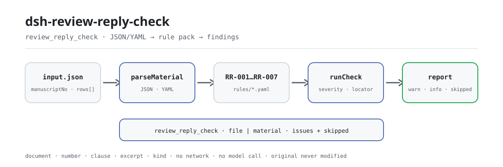

<div align="center">

<picture>
  <source media="(prefers-color-scheme: dark)" srcset="docs/assets/dsh-review-reply-check-flow-dark.svg">
  
</picture>

# dsh-review-reply-check

**Compruebe que cada comentario de revisión reciba respuesta — y que el rastro documental diga qué se cambió y dónde.**

Un verificador puramente local para editores de revistas: lee una tabla de respuestas a los comentarios de revisión, aplica un paquete de reglas versionado y señala huecos de cobertura y de rastro documental — sin modificar el original, sin red, sin llamadas al modelo y sin emitir un veredicto.

[Instalación](#instalación-en-tres-pasos) · [Configuración](#configuración) · [FAQ](#faq) · [简体中文](README.md) · [English](README.en.md) · [Español](README.es.md) · [Português](README.pt.md) · [हिन्दी](README.hi.md)

[](LICENSE)
[](#compatibilidad)
[](https://www.npmjs.com/package/dsh-review-reply-check)
[](https://github.com/PerryLink/dsh-review-reply-check/actions/workflows/ci.yml)
[](#compatibilidad)

[](https://github.com/PerryLink/dsh-review-reply-check/stargazers)
[](https://www.npmjs.com/package/dsh-review-reply-check)
[](https://dshfind.com/plugins/PerryLink/dsh-review-reply-check?ref=badge)
[](https://securityscorecards.dev/viewer/?uri=github.com/PerryLink/dsh-review-reply-check)
[](https://dsh.market/)
[](https://gitee.com/perrylink/dsh-review-reply-check)

```sh
dsh plugin --profile <name> add dsh-review-reply-check
```

</div>

<sub>Complemento de la comunidad, sin relación con DeepSeek. Repositorio canónico: <https://github.com/PerryLink/dsh-review-reply-check> (Gitee es un espejo).</sub>

## Qué es

`dsh-review-reply-check` lee una tabla de respuestas a los comentarios de revisión —la cabecera del manuscrito más una fila por comentario— y comprueba la cobertura y el rastro documental de esa propia tabla: que el texto de cada comentario esté registrado, que toda fila con comentario escrito traiga respuesta del autor, que la respuesta indique la modificación hecha y dónde se hizo, que cada estado de tramitación provenga del vocabulario que usted configure, que las fechas de respuesta caigan dentro del plazo de revisión que la propia tabla declara, que la cabecera declare su manuscrito y su ronda de revisión, y que los números de comentario no se repitan.

Registra la herramienta `review_reply_check` y devuelve hallazgos con `locator` según un paquete de reglas versionado; las comprobaciones que no pueden ejecutarse se escriben en `skipped` con su motivo, nunca pasan en silencio. Todo ocurre en el host: el original no se modifica, no hay red, no se llama a ningún modelo y el plugin no decide si una respuesta es suficiente, si la revisión está bien hecha ni si el manuscrito debe aceptarse.

## Instalación en tres pasos

1. **Instalar** (elija un canal):

   ```sh
   # canal git (última main; equivale a git+https://github.com/PerryLink/dsh-review-reply-check.git)
   dsh plugin --profile web add github:PerryLink/dsh-review-reply-check
   # canal npm (versiones publicadas)
   dsh plugin --profile web add dsh-review-reply-check
   # canal tarball: pnpm pack en este repositorio y luego
   dsh plugin --profile web add ./dsh-review-reply-check-<version>.tgz
   ```

   El paquete publicado incluye `lib/`, `rules/`, `locale/` y `cordis.patch.yml`, así que instalarlo es todo lo necesario.

2. **Configuración mínima** (los valores por defecto sirven; cambie solo las claves que necesite):

   ```yaml
   - insert:
       - id: dsh-review-reply-check
         name: dsh-review-reply-check
         config:
           rulesFile: rules/review-reply-check.yaml
   ```

3. **Comprobar que se montó**:

   ```sh
   dsh --profile web --dump-config | grep 'dsh-review-reply-check'
   ```

   Ejecute el ejemplo incluido desde el repositorio (primero compile):

   ```sh
   pnpm install && pnpm run build
   node samples/quickstart/run.mjs --check
   ```

   ```
   review_reply_check: 1 issue(s) — error 0, warn 1, info 0
   skipped: 2
   ```

   El ejemplo está en `samples/quickstart/input/`, la salida esperada en `samples/quickstart/expected/result.json` y la captura en `docs/assets/quickstart.png`.

**Desinstalar**: `dsh plugin --profile web remove dsh-review-reply-check` (o borre la fila del patch del perfil).

## Capacidades principales

`review_reply_check` hace una sola cosa: compara el material con el paquete de reglas y devuelve diferencias localizables. Acepta `file` o `material` (JSON / YAML), además de `rulesFile` y `only` opcionales.

| Regla | Qué comprueba | Severidad | Tipo de base |
|---|---|---|---|
| `RR-001` | que el texto de cada comentario esté registrado | warn | principle |
| `RR-002` | que todo comentario traiga respuesta | warn | principle |
| `RR-003` | que la respuesta indique la modificación y su ubicación | warn | principle |
| `RR-004` | que el estado provenga de su vocabulario (desactivada por defecto) | info | local |
| `RR-005` | que la fecha de respuesta caiga dentro del plazo registrado | info | local |
| `RR-006` | que la hoja nombre su manuscrito y su ronda | warn | principle |
| `RR-007` | que los números de comentario sean únicos | warn | principle |

El paquete de reglas es datos, no código: sustituir `rules/*.yaml` cambia el conjunto de reglas sin tocar TypeScript. En la carga se valida que cada regla tenga `document` / `number` / `clause` / `excerpt` / `kind` / `source`, y la severidad queda topada por la base: una regla derivada de un principio no pasa de `warn`, una de configuración institucional no pasa de `info`. Una lista de problemas vacía nunca puede leerse como «no hay nada mal»: toda comprobación que no pudo ejecutarse se escribe en `skipped`.

## Qué responde

La tabla siguiente es el conjunto de ejemplos: la primera fila es el caso detallado y las demás son casos breves.

Esta es la salida real del plugin sobre su propio fixture de prueba `RR-001`, no un montaje. El paquete de reglas no inventa citas, así que cada hallazgo nombra la cláusula aplicada y advierte que su texto no se obtuvo.

### Salida detallada

**Herramienta** `review_reply_check`

**Entrada**

~~~json
{"manuscriptNo":"XYZ-2026-0186","title":"某某研究","rows":[{"序号":"R1-1","审稿人":"审稿人一","审稿意见":"","处理状态":"已修改"}]}
~~~

**Salida**

~~~json
{
  "id": "dsh-review-reply-check.RR-001.de09b5a6",
  "ruleId": "RR-001",
  "severity": "warn",
  "locator": {
    "row": 1,
    "field": "comment"
  },
  "found": "第 1 行「comment」为空",
  "expected": "「comment」应填写",
  "fix": "补填审稿意见内容；本条只核对是否填写"
}
~~~

*Observado en `dsh-review-reply-check/tests/fixtures/RR-001/RR-001-unsafe.json (cases.json expects 1×RR-001); executed parseMaterial+runCheck, checkedAt=2026-10-06T00:00:00.000Z`*

| Usted pregunta | Qué responde |
|---|---|
| Una fila trae la respuesta del autor, pero la celda del texto del comentario está vacía. | `RR-001` exige el texto del comentario en cada fila: sin él la respuesta se queda sin objeto y el editor no puede ver a qué comentario corresponde. La regla comprueba solo que la celda esté rellena; no juzga si el comentario es acertado ni si es una discrepancia de juicio académico. |
| El comentario está registrado, pero la celda de respuesta del autor sigue vacía, ¿se informa de ello? | Sí. `RR-002` exige una respuesta en toda fila cuyo comentario esté escrito, porque un comentario pasado por alto no es lo mismo que un desacuerdo que el revisor puede valorar. Comprueba solo que la celda de respuesta esté rellena, no si la respuesta es suficiente o convincente; cuando un comentario realmente no requiere cambios, el paquete aconseja escribir el motivo en esa celda en lugar de dejarla vacía. |
| La respuesta dice que el texto se modificó, pero la nota de revisión y la columna de ubicación están vacías. | `RR-003` exige `revision` y `revisionLocation` en toda fila cuyo campo `response` esté relleno. Comprueba que las dos celdas estén escritas, no que el cambio esté donde ellas dicen: el plugin nunca ve el manuscrito, así que una nota de revisión con página y línea precisas que describe un cambio inexistente también pasa. |
| Todas las filas traen un estado de tramitación. ¿Cómo decide la herramienta si el valor es aceptable? | `RR-004` compara el valor de la columna `status` con la lista que usted configure. Esa lista viene vacía, es decir, sin configurar, así que hasta que la rellene la regla se informa en `skipped` en lugar de pasar en silencio. Comprueba solo que el valor esté en su lista; no decide si un estado dado significa que el comentario quedó bien atendido. Como regla de configuración institucional, su severidad está topada en `info`. |
| La fecha de respuesta es posterior a la columna del plazo, ¿significa que la revisión llegó tarde? | `RR-005` compara `respondedAt` con el `dueAt` que la propia tabla escribe, y un hallazgo solo significa que ambos no concuerdan con el plazo que usted registró, no que la revisión llegara tarde, porque los plazos varían según la revista y el autor puede pedir prórroga. No hay ningún número de días incorporado ni se calcula nada: cuando `dueAt` está vacío la regla se informa en `skipped` en lugar de suponer un plazo. |
| Los comentarios de dos revisores se registraron juntos y ambos numeran desde 1, así que un número de comentario aparece dos veces. | `RR-007` informa de un valor repetido en `commentNo`, porque un duplicado desvirtúa el recuento de cobertura y rompe la correspondencia con el formulario de revisión. Registrarlos con una numeración que lleve al revisor —`R1-3`, `R2-1`— los mantiene únicos; la regla compara los números tal como están escritos y no fusiona ni renumera nada. |

## Normas que sigue

| Documento | Número | Reglas que lo citan |
|---|---|---|
| Norma de composición de revistas científicas y tecnológicas de las universidades chinas | Versión vigente y número de cláusula no verificados en esta pasada | RR-001, RR-002, RR-003, RR-006, RR-007 |
| Normas de revisión por pares y corrección de esta revista (configuración institucional) | Sin norma uniforme (esta regla se basa en el vocabulario de estados de la institución) | RR-004 |
| Normas de revisión por pares y corrección de esta revista (configuración institucional) | Sin norma uniforme (esta regla se basa en el plazo registrado en la tabla) | RR-005 |

El paquete de reglas no inventa citas: esta verificación no obtuvo el texto literal de las cláusulas, así que el `excerpt` de cada regla declara ese hueco y su severidad queda topada en `warn` o `info`.

## Configuración

Todos los parámetros ajustables viven en el esquema Schemastery de `src/config.ts`, por lo que se cambian desde `cordis.yml` sin tocar el código; los umbrales por regla están en el paquete de reglas bajo `rules/`. Una sustitución dirigida por id reemplaza la fila entera: vuelva a declarar todas las claves que necesite.

| Clave | Tipo | Predeterminado | Descripción |
|---|---|---|---|
| `rulesFile` | string | `rules/review-reply-check.yaml` | Ruta del paquete de reglas, relativa a la raíz del paquete |
| `disabledRules` | string[] | `[]` | Ids de reglas que se dejan de ejecutar; cada una aparece en `skipped` |
| `onlyRules` | string[] | `[]` | Ejecutar solo estas reglas; vacío ejecuta todas |
| `skipNotes` | string | `""` | Nota añadida a cada motivo de `skipped` |
| `timeoutMs` | number | `120000` | Presupuesto de tiempo de espera cooperativo de la herramienta |

<details>
<summary>Parámetros por regla</summary>

- `RR-004` `values` — su vocabulario de estados, p. ej. `[modificado, modificado parcialmente, no modificado con motivos, eliminado]`. Vacío significa que no se comprueba.
- `RR-005` lee la columna del plazo de revisión / `dueAt` de la tabla. El plugin nunca deduce un plazo a partir de un número de días.
- `RR-002` y `RR-003` usan `conditionField` / `requiredFields` — qué activa cada exigencia.
- `RR-007` se basa en la columna del número de comentario. Cuando se fusionan comentarios de varios revisores, numérelos por revisor (`R1-3`, `R2-1`) para que la regla pueda distinguirlos.

</details>

Ejemplo de sustitución en el patch del perfil:

```yaml
- insert:
    - id: dsh-review-reply-check
      name: dsh-review-reply-check
      config:
        rulesFile: rules/review-reply-check.yaml
        onlyRules: [RR-001, RR-002, RR-003, RR-006, RR-007]
        timeoutMs: 120000
```

## Formato del material

Acepta JSON o YAML:

```yaml
manuscriptNo: XYZ-2026-0186
title: 某某研究
journal: 某某学报
round: 第 1 轮
dueAt: 2026-05-10
rows:
  - { 序号: R1-1, 审稿人: 审稿人一, 意见类型: 方法, 指向位置: 第 3 节 3.2,
      审稿意见: 3.2 节的样本量未说明估算依据，请补充。,
      作者回应: 同意补充。已在 3.2 节末增加样本量估算说明，并引用既往研究作为依据。,
      修改说明: 新增一段样本量估算依据，引用两项既往研究并给出效应量假设。,
      修改位置: 第 8 页第 12—18 行（修订稿 3.2 节末）,
      处理状态: 已修改, 回应人: 通讯作者, 回应日期: 2026-05-06 }
```

Los nombres de columna se comparan sin distinguir mayúsculas y ignorando espacios, guiones bajos y guiones; se conservan los nombres propios de la tabla, de modo que cada hallazgo nombra la columna que leyó. Los campos son opcionales en la capa de lectura y los valida el motor, así que una exportación parcial produce hallazgos de «falta un dato» en lugar de un fallo.

## Origen de las reglas

Los datos de las reglas están separados del código y viven en `rules/review-reply-check.yaml`. La cabecera del paquete declara el hueco de citas por completo, y la `note` de cada regla repite la parte que le concierne. La guarda de carga que normalmente exige «un `excerpt` debe ser una cita real de al menos ocho caracteres» no distingue una cita de una descripción; por eso este paquete se apoya en la cabecera, en las notas por regla y en una prueba que afirma que cada `excerpt` reconoce el hueco.

Los límites verificados y las conclusiones deliberadamente **no** afirmadas están en `rules/evidence/`. **Cuando tenga los textos, sustituya cada `excerpt` por la cláusula real y suba `kind` a `direct`.**

## FAQ

<details>
<summary>¿El material llega a un modelo o a la red? ¿Dónde se guardan los datos?</summary>

No. El verificador es de solo lectura y se ejecuta en el host: el material entra por `file` o `material`, se analiza en memoria y se entrega a `runCheck`; no se escribe nada de vuelta, no se crean archivos temporales, no hay peticiones de red ni llamadas al modelo — eso es lo que significa «sin red, sin llamada al modelo» en Compatibilidad. El informe solo vuelve a la sesión actual.

</details>

<details>
<summary>¿Una lista de problemas vacía significa que el material está bien?</summary>

No. Toda comprobación que no pudo ejecutarse se escribe en `skipped` con su motivo; la línea roja del paquete es que una lista de problemas vacía nunca puede leerse como «no hay nada mal». Lea juntos `issueCount`, `skippedCount` y `summary`.

</details>

<details>
<summary>¿Por qué `RR-004` nunca se ejecuta?</summary>

Su lista `values` viene vacía, es decir, sin configurar, así que la regla se informa en `skipped` en lugar de pasar en silencio. Solo se ejecuta después de rellenar el vocabulario de estados de su revista; aun así comprueba la pertenencia a su lista, no si un estado significa que el comentario quedó bien atendido.

</details>

<details>
<summary>¿Por qué `RR-005` aparece en `skipped`?</summary>

La tabla no registra plazo de revisión (`dueAt` está vacío). No hay ningún número de días incorporado ni se deduce un plazo; la regla compara fechas de respuesta solo cuando la propia tabla declara el plazo. Un hallazgo significa «esto no concuerda con el plazo que usted registró», nunca «llegó tarde».

</details>

<details>
<summary>¿Cuánto cuesta ejecutarlo? ¿Choca con otros plugins?</summary>

La comprobación es una función pura: sin red, sin llamada al modelo, leyendo el material y el paquete de reglas en memoria sin E/S adicional. El plugin registra exactamente una herramienta, `review_reply_check`; no aporta ninguna clave de servicio, no registra slots de cliente ni prefijos `webServer`, y no modifica objetos globales.

</details>

## Límites de seguridad

- **Material de solo lectura.** `file` o `material` se analiza en memoria; el plugin nunca reescribe el material, no crea archivos temporales y el `target` del informe es solo la ubicación de lectura.
- **Sin veredicto.** Enumera diferencias literales frente a las cláusulas citadas y deja la decisión al editor; una guarda de redacción y un descargo en cada informe lo garantizan.
- **Nunca ve el manuscrito.** `RR-003` comprueba que la nota de revisión y la ubicación estén escritas, nunca que el cambio exista.
- **Sin plazo ni vocabulario incorporados.** `RR-005` solo compara con el `dueAt` de la tabla; los `values` de `RR-004` vienen vacíos.
- **Sin citas inventadas.** Cada `excerpt` dice con todas las letras que el texto de la cláusula no se obtuvo; la validación de carga rechaza una severidad por encima del tope de su base.
- **Falla cerrado.** Un material vacío o mal formado lanza `MaterialError`; el plugin nunca emite un informe vacío que pueda pasar por aprobado.

**Límite:** este plugin comprueba una **tabla de respuestas a los comentarios de revisión** en cuanto a cobertura y evidencia — que cada comentario esté registrado, que cada comentario traiga respuesta del autor, que la respuesta indique la modificación hecha y dónde se hizo, que el estado de tramitación provenga de su vocabulario, que las fechas de respuesta caigan dentro del plazo que la tabla declara, que la hoja nombre su manuscrito y su ronda de revisión, y que los números de comentario sean únicos. **No** decide si una respuesta es suficiente, si la revisión está bien hecha ni si el manuscrito debe aceptarse.

### ⚠️ Qué puede ver y qué no puede ver este plugin

> **Nunca ve el manuscrito.** Puede comprobar que una respuesta diga *dónde* se hizo un cambio — nunca que el cambio esté ahí, ni que atienda al comentario. La nota de `RR-003` y la sección de solución de problemas lo dicen: una nota de revisión segura, bien ubicada y completamente ficticia pasa este plugin.
>
> La relación entre «sin respuesta» y «desacuerdo» es el punto de `RR-002`: un revisor puede aceptar el desacuerdo de un autor, pero no un comentario pasado por alto en silencio, así que la **cobertura** es el indicador más directo de la calidad de la revisión. Por eso la regla se dispara con la celda de respuesta vacía — y su nota aconseja escribir el motivo en lugar de dejar la celda vacía cuando un comentario realmente no necesita cambios.
>
> **No hay ningún plazo de revisión incorporado.** Los plazos varían según la revista y los autores pueden pedir prórrogas, así que `RR-005` compara la fecha de respuesta con el **plazo escrito en la tabla** y se informa en `skipped` cuando esa columna está vacía. Un hallazgo significa «esto no concuerda con el plazo que usted registró», nunca «llegó tarde». El vocabulario de estados también se entrega **vacío** por la misma razón.
>
> **Cada `excerpt` del paquete de reglas dice, con todas las letras, que el texto de la cláusula no se obtuvo.** El régimen está en GB/T 7713.1, la norma china de edición de revistas universitarias, y en las reglas de revisión por pares de cada revista. La verificación no pudo recuperar el texto literal, así que el paquete declara el hueco en el propio campo `excerpt` y mantiene cada regla en `warn` o `info`. **Cuando tenga los textos, sustituya cada `excerpt` por la cláusula real y suba `kind` a `direct`.**

## Limitaciones conocidas

- **Nunca ve el manuscrito.** `RR-003` comprueba que la nota de revisión y la ubicación estén escritas, no que el cambio exista; una nota precisa que describe un cambio que nunca se hizo también pasa.
- **Sin plazo de revisión incorporado.** `RR-005` solo compara con el `dueAt` de la propia tabla; cuando esa columna está vacía informa `skipped` y no supone ningún plazo, ni deduce un número de días por usted.
- **El vocabulario de estados viene vacío.** `RR-004` informa `skipped` en lugar de pasar en silencio hasta que se configure `values`; aun entonces solo comprueba pertenencia.
- **Hueco de citas.** Esta verificación no obtuvo el texto literal de las cláusulas, así que toda regla es `derived-from-principle` o `institutional-configuration`, con severidad topada en `warn` / `info`.
- **Sin conversión de zona horaria.** Toda la aritmética es de hora local sobre las cadenas de entrada; si una hora parece desplazada, revise cómo está escrita la fecha en el material.

## Solución de problemas

- **`RR-003` aceptó una nota de revisión que describe un cambio inexistente.** Comprueba que la ubicación esté *declarada*, nunca que el cambio esté ahí. Comparar exige el manuscrito, que el plugin no ve.
- **`RR-002` salta con un comentario que decidí no atender.** Escriba el motivo en la celda de respuesta. Un revisor puede aceptar un desacuerdo razonado; una celda vacía se lee como «no atendido».
- **`RR-005` se informa como omitida.** La tabla no registra plazo de revisión y el plugin no va a inventarlo.
- **`RR-004` nunca se ejecuta.** Su vocabulario está vacío; rellénelo con los estados de su revista.
- **`RR-007` salta con comentarios de revisores distintos.** Numérelos por revisor para que la tabla fusionada no sea ambigua.
- **Una regla no se ejecutó.** Lea el arreglo `skipped`; indica el id de la regla y el motivo.
- **El plugin se instala pero la herramienta no aparece.** Compruebe que `main` resuelve a `lib/index.mjs` y que `pnpm run build` lo generó; un `main` erróneo hace que el cargador omita la entrada en silencio.
- **`dsh plugin add` rechaza el paquete como incompatible.** La franja de peers cubre `0.1.x` y `0.2.x`; si su runtime queda fuera, conceda una exención explícita: `dsh plugin --profile <name> allow-version dsh-review-reply-check@0.1.0 --dsh-version <runtime> --accept-risk`
- **`check` informa `manifest-peers` como fallo.** El verificador estático compara con una franja de peers codificada que es anterior a la línea 0.2. El runtime aplica la compatibilidad de peers al instalar, así que la franja declarada es la correcta; es un problema conocido de `dsh-plugin-dev`.
- **Los horarios parecen desplazados.** Toda la aritmética es de hora local sobre las cadenas de entrada; no se convierte ninguna zona horaria.

## Compatibilidad

| Superficie | Estado |
|---|---|
| Harness | Rango de peers `>=0.1.2-rc.1 <0.2.0 \|\| >=0.2.0-0 <0.3.0` — verificado para aceptar tanto `0.2.0-rc.2` como `0.2.1-rc.2`. **`engines.dsh` se declara como `>=0.2.1-0 <0.3.0`** y el host lo aplica desde 0.2.1 |
| Node | `^22.19.0 || >=24.0.0` |
| Plataformas | Todas (ESM puro; sin código nativo, sin red, sin llamada al modelo) |
| Modo de herramienta | Funciona en `native` y `ptc`; para un directorio completo use `ptc` |

## Ecosistema y calidad

- [Espejo en Gitee](https://gitee.com/perrylink/dsh-review-reply-check) (espejo sincronizado; GitHub es el canónico)
- [Página del plugin en dshfind](https://dshfind.com/plugins/PerryLink/dsh-review-reply-check) (instalaciones y clasificación)
- [Informe de OpenSSF Scorecard](https://securityscorecards.dev/viewer/?uri=github.com/PerryLink/dsh-review-reply-check) (impulsado por [.github/workflows/scorecard.yml](.github/workflows/scorecard.yml))
- [DSH Market](https://dsh.market/) (publicado)
- [Base de conocimiento del ecosistema](https://perrylink.github.io/dsh-plugin-guide/) — datos medidos, no marketing: guía de desarrollo de plugins · datos de selección · criterios de mantenimiento
- [Elegir un verificador por material](https://perrylink.github.io/zh/checkers/choose/) (índice de la familia)

## Desarrollo

```sh
pnpm install
pnpm run typecheck        # tsc --noEmit
pnpm test                 # vitest: suite compartida de plugins de tabla + fixtures emparejados
pnpm run build            # tsdown -> lib/index.mjs + lib/index.d.mts
pnpm run verify:self-contained
pnpm run check:lockfile
pnpm run check:readmes    # consistencia de los README
pnpm run check:citations
node ../scripts/sync-shared.mjs dsh-review-reply-check   # refresca src/shared desde ../_shared
pnpm pack
```

El plugin es **solo datos**: `src/model.ts` declara la forma de la tabla, el kit compartido aporta el lector y el motor de comprobación, y el paquete de reglas declara cada comprobación. `src/shared/` se copia desde `../_shared`, no se importa — vuelva a ejecutar el comando de sincronización tras cada cambio compartido.

Las imágenes del README se generan programáticamente con [`scripts/gen-readme-assets.py`](scripts/gen-readme-assets.py) (Python + Pillow) y se pueden volver a ejecutar: `python scripts/gen-readme-assets.py`.

## Familia y agradecimientos

Este proyecto forma parte de la familia de plugins de DeepSeek Harness de [PerryLink](https://github.com/PerryLink) (todos Apache-2.0). Si le resulta útil, **una estrella ayuda a que el siguiente lo encuentre** — no desbloquea ninguna función.

- [@PerryLink](https://github.com/PerryLink) — creador y mantenedor: el paquete de reglas de cobertura de respuestas, la herramienta `review_reply_check` y la documentación en cinco idiomas.

<details>
<summary>Ver todos los plugins</summary>

| Plugin | Estado |
|---|---|
| **[dsh-aqua-input-check](https://github.com/PerryLink/dsh-aqua-input-check)** |  |
| **[dsh-archive-check](https://github.com/PerryLink/dsh-archive-check)** |  |
| **[dsh-auto-review](https://github.com/PerryLink/dsh-auto-review)** |  |
| **[dsh-autotier](https://github.com/PerryLink/dsh-autotier)** | 🧊 CONGELADO — ver el README del repo |
| **[dsh-bid-ca-precheck](https://github.com/PerryLink/dsh-bid-ca-precheck)** |  |
| **[dsh-bid-qual-check](https://github.com/PerryLink/dsh-bid-qual-check)** |  |
| **[dsh-cert-mcp](https://github.com/PerryLink/dsh-cert-mcp)** | 🧊 CONGELADO — ver el README del repo |
| **[dsh-checkpoint-rewind](https://github.com/PerryLink/dsh-checkpoint-rewind)** |  |
| **[dsh-click](https://github.com/PerryLink/dsh-click)** |  |
| **[dsh-composer-history](https://github.com/PerryLink/dsh-composer-history)** |  |
| **[dsh-contract-stance](https://github.com/PerryLink/dsh-contract-stance)** |  |
| **[dsh-customs-doc-check](https://github.com/PerryLink/dsh-customs-doc-check)** |  |
| **[dsh-data-quality](https://github.com/PerryLink/dsh-data-quality)** | 🧊 CONGELADO — ver el README del repo |
| **[dsh-demurrage-ledger](https://github.com/PerryLink/dsh-demurrage-ledger)** |  |
| **[dsh-doublecheck](https://github.com/PerryLink/dsh-doublecheck)** |  |
| **[dsh-drill-script-check](https://github.com/PerryLink/dsh-drill-script-check)** |  |
| **[dsh-eia-guide-check](https://github.com/PerryLink/dsh-eia-guide-check)** |  |
| **[dsh-emergency-plan](https://github.com/PerryLink/dsh-emergency-plan)** |  |
| **[dsh-essay-rubric-check](https://github.com/PerryLink/dsh-essay-rubric-check)** |  |
| **[dsh-evidence-check](https://github.com/PerryLink/dsh-evidence-check)** |  |
| **[dsh-export-ctl-check](https://github.com/PerryLink/dsh-export-ctl-check)** |  |
| **[dsh-fast](https://github.com/PerryLink/dsh-fast)** |  |
| **[dsh-fmea-table-check](https://github.com/PerryLink/dsh-fmea-table-check)** |  |
| **[dsh-forecast-penalty](https://github.com/PerryLink/dsh-forecast-penalty)** |  |
| **[dsh-fund-research](https://github.com/PerryLink/dsh-fund-research)** |  |
| **[dsh-github](https://github.com/PerryLink/dsh-github)** |  |
| **[dsh-gongwen-flow-check](https://github.com/PerryLink/dsh-gongwen-flow-check)** |  |
| **[dsh-gongwen-word-check](https://github.com/PerryLink/dsh-gongwen-word-check)** |  |
| **[dsh-guard-plan-qc](https://github.com/PerryLink/dsh-guard-plan-qc)** |  |
| **[dsh-hazchem-check](https://github.com/PerryLink/dsh-hazchem-check)** |  |
| **[dsh-hazplan-check](https://github.com/PerryLink/dsh-hazplan-check)** |  |
| **[dsh-hidden-risk-map](https://github.com/PerryLink/dsh-hidden-risk-map)** |  |
| **[dsh-hs-classify](https://github.com/PerryLink/dsh-hs-classify)** |  |
| **[dsh-icd-rule-check](https://github.com/PerryLink/dsh-icd-rule-check)** |  |
| **[dsh-industry-research](https://github.com/PerryLink/dsh-industry-research)** |  |
| **[dsh-lawcite-adapter](https://github.com/PerryLink/dsh-lawcite-adapter)** |  |
| **[dsh-laya](https://github.com/PerryLink/dsh-laya)** |  |
| **[dsh-lc-doc-check](https://github.com/PerryLink/dsh-lc-doc-check)** |  |
| **[dsh-learning-gap-check](https://github.com/PerryLink/dsh-learning-gap-check)** |  |
| **[dsh-library](https://github.com/PerryLink/dsh-library)** |  |
| **[dsh-local-ai](https://github.com/PerryLink/dsh-local-ai)** |  |
| **[dsh-lsp-actions](https://github.com/PerryLink/dsh-lsp-actions)** |  |
| **[dsh-mask](https://github.com/PerryLink/dsh-mask)** |  |
| **[dsh-mcp-panel](https://github.com/PerryLink/dsh-mcp-panel)** |  |
| **[dsh-medrec-qc](https://github.com/PerryLink/dsh-medrec-qc)** |  |
| **[dsh-memento](https://github.com/PerryLink/dsh-memento)** | 🧊 CONGELADO — ver el README del repo |
| **[dsh-nsfc-form-check](https://github.com/PerryLink/dsh-nsfc-form-check)** |  |
| **[dsh-nurse-record-check](https://github.com/PerryLink/dsh-nurse-record-check)** |  |
| **[dsh-observe](https://github.com/PerryLink/dsh-observe)** |  |
| **[dsh-origin-rvc-check](https://github.com/PerryLink/dsh-origin-rvc-check)** |  |
| **[dsh-ota-review-check](https://github.com/PerryLink/dsh-ota-review-check)** |  |
| **[dsh-output-styles](https://github.com/PerryLink/dsh-output-styles)** |  |
| **[dsh-paper-doc-adapter](https://github.com/PerryLink/dsh-paper-doc-adapter)** |  |
| **[dsh-permission-rules](https://github.com/PerryLink/dsh-permission-rules)** |  |
| **[dsh-permit-report-check](https://github.com/PerryLink/dsh-permit-report-check)** |  |
| **[dsh-pipeline-check](https://github.com/PerryLink/dsh-pipeline-check)** |  |
| **[dsh-pleading-draft](https://github.com/PerryLink/dsh-pleading-draft)** |  |
| **[dsh-plugin-doctor](https://github.com/PerryLink/dsh-plugin-doctor)** | 🚫 RETIRADO (repo archivado) |
| **[dsh-plugin-guide](https://github.com/PerryLink/dsh-plugin-guide)** |  |
| **[dsh-plugin-kit](https://github.com/PerryLink/dsh-plugin-kit)** | 🚫 RETIRADO (repo archivado) |
| **[dsh-plugin-upgrade](https://github.com/PerryLink/dsh-plugin-upgrade)** | 🚫 RETIRADO (repo archivado) |
| **[dsh-policy-brief-draft](https://github.com/PerryLink/dsh-policy-brief-draft)** |  |
| **[dsh-power-loss-split](https://github.com/PerryLink/dsh-power-loss-split)** |  |
| **[dsh-power-ticket-check](https://github.com/PerryLink/dsh-power-ticket-check)** |  |
| **[dsh-ppap-check](https://github.com/PerryLink/dsh-ppap-check)** |  |
| **[dsh-protest-deadline](https://github.com/PerryLink/dsh-protest-deadline)** |  |
| **[dsh-railway-window](https://github.com/PerryLink/dsh-railway-window)** |  |
| **[dsh-repair-order-qc](https://github.com/PerryLink/dsh-repair-order-qc)** |  |
| **[dsh-research-report](https://github.com/PerryLink/dsh-research-report)** |  |
| **[dsh-review-reply-check](https://github.com/PerryLink/dsh-review-reply-check)** |  |
| **[dsh-rulefile-check](https://github.com/PerryLink/dsh-rulefile-check)** |  |
| **[dsh-safety-brief-check](https://github.com/PerryLink/dsh-safety-brief-check)** |  |
| **[dsh-score](https://github.com/PerryLink/dsh-score)** | 🧊 CONGELADO — ver el README del repo |
| **[dsh-session-sync](https://github.com/PerryLink/dsh-session-sync)** |  |
| **[dsh-site-log-check](https://github.com/PerryLink/dsh-site-log-check)** |  |
| **[dsh-skill-pack-security](https://github.com/PerryLink/dsh-skill-pack-security)** |  |
| **[dsh-soe-decision-check](https://github.com/PerryLink/dsh-soe-decision-check)** |  |
| **[dsh-soilwater-check](https://github.com/PerryLink/dsh-soilwater-check)** |  |
| **[dsh-sop-sync-check](https://github.com/PerryLink/dsh-sop-sync-check)** |  |
| **[dsh-spc-gbt-adapter](https://github.com/PerryLink/dsh-spc-gbt-adapter)** |  |
| **[dsh-talk](https://github.com/PerryLink/dsh-talk)** |  |
| **[dsh-tender-extract](https://github.com/PerryLink/dsh-tender-extract)** |  |
| **[dsh-tender-matrix](https://github.com/PerryLink/dsh-tender-matrix)** |  |
| **[dsh-test-drive](https://github.com/PerryLink/dsh-test-drive)** |  |
| **[dsh-ticktick](https://github.com/PerryLink/dsh-ticktick)** | 🚫 RETIRADO (repo archivado) |
| **[dsh-translate](https://github.com/PerryLink/dsh-translate)** |  |
| **[dsh-warranty-calc](https://github.com/PerryLink/dsh-warranty-calc)** |  |
| **[dsh-budget](https://github.com/PerryLink/dsh-budget)** | 🧊 CONGELADO — ver el README del repo |
| **[dsh-claude-move](https://github.com/PerryLink/dsh-claude-move)** | 🧊 CONGELADO — ver el README del repo |
| **[dsh-defend](https://github.com/PerryLink/dsh-defend)** | 🧊 CONGELADO — ver el README del repo |
| **[dsh-draw](https://github.com/PerryLink/dsh-draw)** | 🧊 CONGELADO — ver el README del repo |
| **[dsh-reach](https://github.com/PerryLink/dsh-reach)** | 🧊 CONGELADO — ver el README del repo |
| **[dsh-background-agents](https://github.com/PerryLink/dsh-background-agents)** | 🚫 RETIRADO (repo archivado) |
| **[dsh-session-pin](https://github.com/PerryLink/dsh-session-pin)** | 🚫 RETIRADO (repo archivado) |
| **[dsh-team-rooms](https://github.com/PerryLink/dsh-team-rooms)** | 🚫 RETIRADO (repo archivado) |

</details>

## License

[LICENSE](LICENSE) (Apache License 2.0) © 2026 dsh-review-reply-check contributors

<p align="center"><sub>Apache-2.0 · Complemento de la comunidad, sin relación con DeepSeek.</sub></p>
