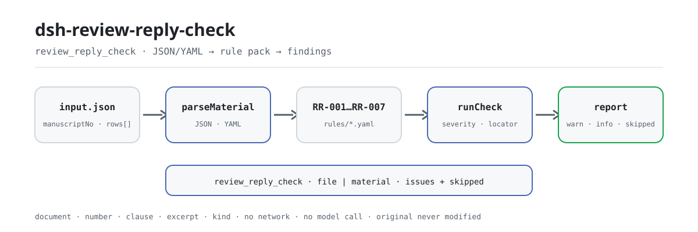

<div align="center">

<picture>
  <source media="(prefers-color-scheme: dark)" srcset="docs/assets/dsh-review-reply-check-flow-dark.svg">
  
</picture>

# dsh-review-reply-check

**हर समीक्षा टिप्पणी का उत्तर सुनिश्चित करें — और यह भी कि अभिलेख बताए कि क्या बदला और कहाँ बदला।**

पत्रिका संपादकों के लिए पूर्णतः होस्ट-साइड जाँचक: समीक्षा टिप्पणियों के उत्तर की एक तालिका पढ़ता है, संस्करणबद्ध नियम-पैक लागू करता है और व्याप्ति तथा अभिलेख की कमियाँ बताता है — मूल को बदले बिना, नेटवर्क या मॉडल कॉल किए बिना, और कोई निर्णय दिए बिना।

[इंस्टॉल](#तीन-चरणों-में-शुरुआत) · [कॉन्फ़िगरेशन](#कॉन्फ़िगरेशन) · [FAQ](#faq) · [简体中文](README.md) · [English](README.en.md) · [Español](README.es.md) · [Português](README.pt.md) · [हिन्दी](README.hi.md)

[](LICENSE)
[](#अनुकूलता)
[](https://www.npmjs.com/package/dsh-review-reply-check)
[](https://github.com/PerryLink/dsh-review-reply-check/actions/workflows/ci.yml)
[](#अनुकूलता)

[](https://github.com/PerryLink/dsh-review-reply-check/stargazers)
[](https://www.npmjs.com/package/dsh-review-reply-check)
[](https://dshfind.com/plugins/PerryLink/dsh-review-reply-check?ref=badge)
[](https://securityscorecards.dev/viewer/?uri=github.com/PerryLink/dsh-review-reply-check)
[](https://dsh.market/)
[](https://gitee.com/perrylink/dsh-review-reply-check)

```sh
dsh plugin --profile <name> add dsh-review-reply-check
```

</div>

<sub>सामुदायिक प्लगइन, DeepSeek से संबद्ध नहीं। आधिकारिक रेपो: <https://github.com/PerryLink/dsh-review-reply-check> (Gitee एक मिरर है)।</sub>

## यह क्या है

`dsh-review-reply-check` समीक्षा टिप्पणियों के उत्तर की एक तालिका पढ़ता है — पांडुलिपि का हेडर और प्रत्येक टिप्पणी की एक पंक्ति — और उसी तालिका की व्याप्ति तथा अभिलेख-निरंतरता की जाँच करता है: क्या प्रत्येक टिप्पणी का पाठ दर्ज है, क्या टिप्पणी लिखी होने पर उस पंक्ति में लेखक का उत्तर भी है, क्या उत्तर में किया गया संशोधन और उसका स्थान लिखा है, क्या प्रत्येक निपटान-स्थिति आपके द्वारा कॉन्फ़िगर शब्दावली से ली गई है, क्या उत्तर की तारीखें तालिका में ही लिखी समीक्षा-सीमा के भीतर हैं, क्या तालिका का हेडर अपनी पांडुलिपि और समीक्षा-चक्र बताता है, और क्या टिप्पणी-क्रमांक दोहराए नहीं गए हैं।

यह `review_reply_check` उपकरण पंजीकृत करता है और संस्करणबद्ध नियम-पैक के अंतर्गत `locator` सहित निष्कर्ष लौटाता है; जो जाँचें नहीं चल सकीं वे कारण के साथ `skipped` में लिखी जाती हैं, कभी चुपचाप पास नहीं होतीं। सब कुछ होस्ट पर: मूल नहीं बदला जाता, कोई नेटवर्क नहीं, कोई मॉडल कॉल नहीं, और प्लगइन यह तय नहीं करता कि उत्तर पर्याप्त है, संशोधन ठीक है, या पांडुलिपि स्वीकार की जानी चाहिए।

## तीन चरणों में शुरुआत

1. **इंस्टॉल करें** (कोई एक चैनल चुनें):

   ```sh
   # git चैनल (नवीनतम main; git+https://github.com/PerryLink/dsh-review-reply-check.git के समान)
   dsh plugin --profile web add github:PerryLink/dsh-review-reply-check
   # npm चैनल (प्रकाशित संस्करण)
   dsh plugin --profile web add dsh-review-reply-check
   # tarball चैनल: इस रेपो में pnpm pack के बाद
   dsh plugin --profile web add ./dsh-review-reply-check-<version>.tgz
   ```

   प्रकाशित पैकेज में `lib/`, `rules/`, `locale/` और `cordis.patch.yml` शामिल हैं, इसलिए इंस्टॉल ही पर्याप्त है।

2. **न्यूनतम कॉन्फ़िगरेशन** (डिफ़ॉल्ट चलते हैं; केवल ज़रूरी कुंजियाँ बदलें):

   ```yaml
   - insert:
       - id: dsh-review-reply-check
         name: dsh-review-reply-check
         config:
           rulesFile: rules/review-reply-check.yaml
   ```

3. **जाँचें कि माउंट हुआ**:

   ```sh
   dsh --profile web --dump-config | grep 'dsh-review-reply-check'
   ```

   रेपो में शामिल नमूना चलाएँ (पहले बिल्ड करें):

   ```sh
   pnpm install && pnpm run build
   node samples/quickstart/run.mjs --check
   ```

   ```
   review_reply_check: 1 issue(s) — error 0, warn 1, info 0
   skipped: 2
   ```

   नमूना `samples/quickstart/input/` में, अपेक्षित आउटपुट `samples/quickstart/expected/result.json` में और स्क्रीनशॉट `docs/assets/quickstart.png` में है।

**अनइंस्टॉल**: `dsh plugin --profile web remove dsh-review-reply-check` (या प्रोफ़ाइल पैच से वह पंक्ति हटा दें)।

## मुख्य क्षमताएँ

`review_reply_check` एक ही काम करता है: सामग्री की नियम-पैक से तुलना करके स्थान-योग्य अंतर लौटाना। यह `file` या `material` (JSON / YAML) और वैकल्पिक `rulesFile` तथा `only` लेता है।

| नियम | क्या जाँचता है | गंभीरता | आधार प्रकार |
|---|---|---|---|
| `RR-001` | प्रत्येक टिप्पणी का पाठ दर्ज है | warn | principle |
| `RR-002` | प्रत्येक टिप्पणी का उत्तर है | warn | principle |
| `RR-003` | उत्तर संशोधन और उसका स्थान बताता है | warn | principle |
| `RR-004` | स्थिति आपकी शब्दावली से आती है (डिफ़ॉल्ट रूप से बंद) | info | local |
| `RR-005` | उत्तर की तारीख दर्ज सीमा के भीतर है | info | local |
| `RR-006` | तालिका अपनी पांडुलिपि और चक्र बताती है | warn | principle |
| `RR-007` | टिप्पणी-क्रमांक अद्वितीय हैं | warn | principle |

नियम-पैक डेटा है, कोड नहीं: `rules/*.yaml` बदलने से TypeScript छुए बिना नियम-समुच्चय बदल जाता है। लोड पर हर नियम के `document` / `number` / `clause` / `excerpt` / `kind` / `source` की जाँच होती है, और गंभीरता आधार से सीमित रहती है — सिद्धांत-व्युत्पन्न नियम `warn` से ऊपर नहीं, संस्थागत-कॉन्फ़िगरेशन नियम `info` से ऊपर नहीं। खाली समस्या-सूची को कभी «कुछ गलत नहीं» नहीं पढ़ा जा सकता: जो जाँच नहीं चल सकी, वह `skipped` में लिखी जाती है।

## यह किन सवालों का जवाब देता है

नीचे दी गई तालिका उदाहरण-समुच्चय है: पहली पंक्ति विस्तृत केस है, बाकी संक्षिप्त केस हैं।

यह प्लगइन का अपने ही `RR-001` टेस्ट फ़िक्स्चर पर वास्तविक आउटपुट है, कोई नकली चित्र नहीं। नियम-पैक उद्धरण नहीं गढ़ता, इसलिए हर निष्कर्ष लागू किए गए खंड का नाम और यह भी बताता है कि उसका मूल पाठ इस बार प्राप्त नहीं हुआ।

### विस्तृत आउटपुट

**उपकरण** `review_reply_check`

**इनपुट**

~~~json
{"manuscriptNo":"XYZ-2026-0186","title":"某某研究","rows":[{"序号":"R1-1","审稿人":"审稿人一","审稿意见":"","处理状态":"已修改"}]}
~~~

**आउटपुट**

~~~json
{
  "id": "dsh-review-reply-check.RR-001.de09b5a6",
  "ruleId": "RR-001",
  "severity": "warn",
  "locator": {
    "row": 1,
    "field": "comment"
  },
  "found": "第 1 行「comment」为空",
  "expected": "「comment」应填写",
  "fix": "补填审稿意见内容；本条只核对是否填写"
}
~~~

*स्रोत `dsh-review-reply-check/tests/fixtures/RR-001/RR-001-unsafe.json (cases.json expects 1×RR-001); executed parseMaterial+runCheck, checkedAt=2026-10-06T00:00:00.000Z`*

| आपका सवाल | इसका जवाब |
|---|---|
| एक पंक्ति में लेखक का उत्तर है, पर टिप्पणी का पाठ रखने वाली कोशिका खाली है। | `RR-001` हर पंक्ति में टिप्पणी का पाठ चाहता है: उसके बिना उत्तर का कोई विषय नहीं रहता और संपादक यह नहीं देख पाता कि उत्तर किस टिप्पणी का है। नियम केवल यह देखता है कि कोशिका भरी है; यह नहीं आँकता कि टिप्पणी उचित है या वह शैक्षणिक मतभेद की बात है। |
| टिप्पणी दर्ज है, पर लेखक के उत्तर की कोशिका अब भी खाली है — क्या यह दर्ज होता है? | हाँ। `RR-002` हर उस पंक्ति में उत्तर की अपेक्षा करता है जिसमें टिप्पणी लिखी हो, क्योंकि टिप्पणी को चुपचाप छोड़ देना और समीक्षक द्वारा स्वीकार्य असहमति दो अलग बातें हैं। यह केवल देखता है कि उत्तर की कोशिका भरी है, यह नहीं कि उत्तर पर्याप्त है या समीक्षक को संतुष्ट करता है; जिस टिप्पणी पर वास्तव में कोई बदलाव आवश्यक न हो, उसके लिए नियम-संग्रह उस कोशिका में कारण लिखने की सलाह देता है, खाली छोड़ने की नहीं। |
| उत्तर में लिखा है कि पाठ संशोधित कर दिया गया, पर संशोधन विवरण और स्थान का कॉलम खाली है। | `RR-003` हर उस पंक्ति में `revision` और `revisionLocation` दोनों की अपेक्षा करता है जिसमें `response` भरा हो। यह देखता है कि दोनों कोशिकाएँ लिखी गई हैं, यह नहीं कि बदलाव वहीं है जहाँ उनमें लिखा है — प्लगइन पांडुलिपि को कभी नहीं देखता, इसलिए ठीक पृष्ठ-पंक्ति बताने वाला, पर वास्तव में न होने वाला संशोधन विवरण भी पास हो जाता है। |
| हर पंक्ति में निपटान-स्थिति भरी है। मान स्वीकार्य है या नहीं, यह उपकरण कैसे तय करता है? | `RR-004` `status` कॉलम के मान की तुलना उस सूची से करता है जो आप कॉन्फ़िगर करते हैं। यह सूची खाली आती है, अर्थात् कॉन्फ़िगर नहीं है, इसलिए जब तक आप उसे न भरें, यह नियम चुपचाप पास होने के बजाय `skipped` में स्वयं को दर्ज करता है। यह केवल देखता है कि मान आपकी सूची में है; यह नहीं तय करता कि कोई स्थिति यह दर्शाती है कि टिप्पणी ठीक से निपटाई गई। संस्थागत कॉन्फ़िगरेशन वाला नियम होने के कारण इसकी गंभीरता `info` तक सीमित है। |
| उत्तर की तारीख सीमा-कॉलम के बाद की है — क्या इसका अर्थ है कि संशोधन विलंब से आया? | `RR-005` `respondedAt` की तुलना तालिका में ही लिखी `dueAt` से करता है, और मेल न खाने का अर्थ केवल यह है कि दोनों आपके दर्ज की गई सीमा से मेल नहीं खाते, यह नहीं कि संशोधन देर से आया, क्योंकि सीमाएँ जर्नल के अनुसार बदलती हैं और लेखक अवधि-विस्तार माँग सकता है। कोई दिन-संख्या अंदर नहीं बैठाई गई और कोई गणना नहीं होती: `dueAt` खाली होने पर यह नियम कोई सीमा मान लेने के बजाय `skipped` में स्वयं को दर्ज करता है। |
| दो समीक्षकों की टिप्पणियाँ एक साथ दर्ज हुईं और दोनों की गिनती 1 से शुरू होती है, इसलिए एक टिप्पणी-क्रमांक दो बार आता है। | `RR-007` `commentNo` में दोहराया गया मान दर्ज करता है, क्योंकि दोहरी संख्या व्याप्ति की गिनती को गलत बनाती है और समीक्षा-फ़ॉर्म से मेल तोड़ देती है। एक साथ दर्ज करते समय संख्या में समीक्षक जोड़ें — `R1-3`, `R2-1` — जिससे वे अद्वितीय रहें; यह नियम संख्याओं की तुलना वैसे ही करता है जैसे वे लिखी हैं, न मिलाता है न नए सिरे से क्रमांकित करता है। |

## यह किन मानकों पर आधारित है

| दस्तावेज़ | संख्यांक | इन्हें उद्धृत करने वाले नियम |
|---|---|---|
| चीनी विश्वविद्यालय विज्ञान-तकनीकी पत्रिका संपादन मानक | वर्तमान संस्करण और धारा-संख्या इस बार सत्यापित नहीं | RR-001, RR-002, RR-003, RR-006, RR-007 |
| इस पत्रिका के सहकर्मी-समीक्षा और संशोधन नियम (संस्थागत कॉन्फ़िगरेशन) | कोई एकसमान मानक नहीं (यह नियम संस्था की स्थिति-शब्दावली पर आधारित है) | RR-004 |
| इस पत्रिका के सहकर्मी-समीक्षा और संशोधन नियम (संस्थागत कॉन्फ़िगरेशन) | कोई एकसमान मानक नहीं (यह नियम तालिका में लिखी सीमा पर आधारित है) | RR-005 |

नियम-पैक उद्धरण नहीं गढ़ता: इस सत्यापन में धाराओं का शब्दशः पाठ नहीं मिला, इसलिए हर नियम का `excerpt` यह कमी बताता है और उसकी गंभीरता `warn` या `info` तक सीमित रहती है।

## कॉन्फ़िगरेशन

सभी समायोज्य पैरामीटर `src/config.ts` की Schemastery स्कीमा में हैं, इसलिए कोड बदले बिना `cordis.yml` से बदले जा सकते हैं; प्रति-नियम सीमाएँ `rules/` के नियम-पैक में हैं। id-लक्षित ओवरराइड पूरी पंक्ति बदल देता है — ज़रूरी सभी कुंजियाँ दोबारा लिखें।

| कुंजी | प्रकार | डिफ़ॉल्ट | विवरण |
|---|---|---|---|
| `rulesFile` | string | `rules/review-reply-check.yaml` | नियम-पैक का पथ, पैकेज रूट के सापेक्ष |
| `disabledRules` | string[] | `[]` | बंद करने वाले नियम id; प्रत्येक `skipped` में दिखता है |
| `onlyRules` | string[] | `[]` | केवल ये नियम चलाएँ; खाली होने पर सभी नियम चलते हैं |
| `skipNotes` | string | `""` | हर `skipped` कारण के आगे जोड़ी जाने वाली टिप्पणी |
| `timeoutMs` | number | `120000` | उपकरण का सहकारी समय-सीमा बजट |

<details>
<summary>प्रति-नियम पैरामीटर</summary>

- `RR-004` `values` — आपकी स्थिति-शब्दावली, जैसे `[संशोधित, आंशिक संशोधित, कारण सहित असंशोधित, हटाया गया]`। खाली का अर्थ है कोई जाँच नहीं।
- `RR-005` तालिका का समीक्षा-सीमा / `dueAt` कॉलम पढ़ता है। प्लगइन कभी दिन-गिनती से सीमा नहीं निकालता।
- `RR-002` और `RR-003` `conditionField` / `requiredFields` का उपयोग करते हैं — कौन-सी अपेक्षा कब सक्रिय होती है।
- `RR-007` टिप्पणी-क्रमांक कॉलम पर आधारित है। कई समीक्षकों की टिप्पणियाँ मिलाने पर समीक्षक के अनुसार क्रमांक दें (`R1-3`, `R2-1`) ताकि नियम उन्हें अलग पहचान सके।

</details>

प्रोफ़ाइल पैच में ओवरराइड का उदाहरण:

```yaml
- insert:
    - id: dsh-review-reply-check
      name: dsh-review-reply-check
      config:
        rulesFile: rules/review-reply-check.yaml
        onlyRules: [RR-001, RR-002, RR-003, RR-006, RR-007]
        timeoutMs: 120000
```

## सामग्री का प्रारूप

JSON या YAML स्वीकार्य है:

```yaml
manuscriptNo: XYZ-2026-0186
title: 某某研究
journal: 某某学报
round: 第 1 轮
dueAt: 2026-05-10
rows:
  - { 序号: R1-1, 审稿人: 审稿人一, 意见类型: 方法, 指向位置: 第 3 节 3.2,
      审稿意见: 3.2 节的样本量未说明估算依据，请补充。,
      作者回应: 同意补充。已在 3.2 节末增加样本量估算说明，并引用既往研究作为依据。,
      修改说明: 新增一段样本量估算依据，引用两项既往研究并给出效应量假设。,
      修改位置: 第 8 页第 12—18 行（修订稿 3.2 节末）,
      处理状态: 已修改, 回应人: 通讯作者, 回应日期: 2026-05-06 }
```

कॉलम नाम बिना केस-भेद और स्पेस, अंडरस्कोर तथा हाइफ़न छोड़कर मिलाए जाते हैं; तालिका के अपने कॉलम नाम सुरक्षित रहते हैं, इसलिए हर निष्कर्ष उसी कॉलम का नाम लेता है जिसे उसने पढ़ा। फ़ील्ड पढ़ने की परत में वैकल्पिक हैं और जाँच इंजन उन्हें सत्यापित करता है, इसलिए आंशिक निर्यात पर क्रैश के बजाय «अनुपस्थित» श्रेणी के निष्कर्ष मिलते हैं।

## नियमों का स्रोत

नियम-डेटा कोड से अलग है और `rules/review-reply-check.yaml` में रहता है। पैक का हेडर उद्धरण-कमी पूरी तरह बताता है, और हर नियम की `note` उससे संबंधित हिस्सा दोहराती है। लोड-समय की गार्ड जो सामान्यतः «`excerpt` कम से कम आठ अक्षरों का वास्तविक उद्धरण हो» लागू करती है, वह उद्धरण और विवरण में अंतर नहीं कर सकती — इसलिए यह पैक हेडर, प्रति-नियम नोट और उस परीक्षण पर टिका है जो दावा करता है कि हर `excerpt` इस कमी को स्वीकारता है।

सत्यापित सीमाएँ और जान-बूझकर **न** कहे गए निष्कर्ष `rules/evidence/` में हैं। **पाठ मिलने पर हर `excerpt` को वास्तविक धारा से बदलें और `kind` को `direct` करें।**

## FAQ

<details>
<summary>क्या सामग्री मॉडल या नेटवर्क तक जाती है? डेटा कहाँ रहता है?</summary>

नहीं। जाँचक केवल-पढ़ने वाला और होस्ट-साइड है: सामग्री `file` या `material` से आती है, मेमोरी में पढ़ी जाती है और `runCheck` को दी जाती है; कुछ भी वापस नहीं लिखा जाता, कोई अस्थायी फ़ाइल नहीं बनती, कोई नेटवर्क अनुरोध नहीं होता और कोई मॉडल कॉल नहीं होती — अनुकूलता में «नेटवर्क नहीं, मॉडल कॉल नहीं» का यही अर्थ है। रिपोर्ट केवल वर्तमान सत्र को लौटती है।

</details>

<details>
<summary>क्या खाली समस्या-सूची का अर्थ है कि सामग्री ठीक है?</summary>

नहीं। जो जाँच नहीं चल सकी, वह कारण के साथ `skipped` में जाती है; नियम-पैक की लक्ष्मण-रेखा है कि खाली समस्या-सूची को कभी «कुछ गलत नहीं» नहीं पढ़ा जा सकता। `issueCount`, `skippedCount` और `summary` को साथ देखें।

</details>

<details>
<summary>`RR-004` कभी क्यों नहीं चलता?</summary>

इसकी `values` सूची खाली आती है, अर्थात् कॉन्फ़िगर नहीं है, इसलिए नियम चुपचाप पास होने के बजाय `skipped` में स्वयं को दर्ज करता है। अपनी पत्रिका की स्थिति-शब्दावली भरने के बाद ही यह चलता है; तब भी यह आपकी सूची में सदस्यता जाँचता है, यह नहीं कि कोई स्थिति टिप्पणी के ठीक से निपटाए जाने का अर्थ है।

</details>

<details>
<summary>`RR-005` `skipped` में क्यों दिखता है?</summary>

तालिका कोई समीक्षा-सीमा दर्ज नहीं करती (`dueAt` खाली है)। कोई दिन-संख्या अंदर नहीं बैठाई गई और कोई सीमा अनुमानित नहीं होती; नियम उत्तर की तारीखों की तुलना केवल तब करता है जब तालिका स्वयं सीमा बताती है। मेल का अर्थ है «यह आपके दर्ज सीमा से मेल नहीं खाता», कभी «देर हो गई» नहीं।

</details>

<details>
<summary>खर्च कितना है? क्या यह दूसरे प्लगइनों से टकराता है?</summary>

जाँच एक शुद्ध फ़ंक्शन है: नेटवर्क नहीं, मॉडल कॉल नहीं, सामग्री और नियम-पैक मेमोरी में पढ़े जाते हैं और कोई अतिरिक्त I/O नहीं होता। प्लगइन ठीक एक उपकरण, `review_reply_check`, पंजीकृत करता है; कोई सेवा-कुंजी नहीं देता, कोई क्लाइंट स्लॉट या `webServer` प्रीफ़िक्स पंजीकृत नहीं करता, और कोई ग्लोबल ऑब्जेक्ट नहीं बदलता।

</details>

## सुरक्षा सीमाएँ

- **केवल-पढ़ने वाली सामग्री।** `file` या `material` मेमोरी में पढ़ी जाती है; प्लगइन सामग्री को कभी नहीं लिखता, कोई अस्थायी फ़ाइल नहीं बनाता, और रिपोर्ट का `target` केवल पढ़ने का स्थान है।
- **कोई निर्णय नहीं।** यह उद्धृत धाराओं के सामने शाब्दिक अंतर सूचीबद्ध करता है और निर्णय संपादक पर छोड़ता है; शब्द-गार्ड और हर रिपोर्ट पर अस्वीकरण इसे लागू करते हैं।
- **पांडुलिपि कभी नहीं दिखती।** `RR-003` जाँचता है कि संशोधन विवरण और स्थान लिखे हैं, यह नहीं कि बदलाव मौजूद है।
- **कोई अंतर्निहित सीमा या स्थिति-शब्दावली नहीं।** `RR-005` केवल तालिका के `dueAt` से तुलना करता है; `RR-004` के `values` खाली आते हैं।
- **कोई गढ़ा उद्धरण नहीं।** हर `excerpt` स्पष्ट शब्दों में कहता है कि धारा का पाठ नहीं मिला; लोड-समय सत्यापन आधार की सीमा से ऊपर की गंभीरता अस्वीकार करता है।
- **फ़ेल-क्लोज़्ड।** खाली या विकृत सामग्री `MaterialError` फेंकती है; प्लगइन कभी खाली रिपोर्ट नहीं देता जो पास होने का रूप धारण कर सके।

**सीमा:** यह प्लगइन एक **समीक्षा टिप्पणी उत्तर-तालिका** की व्याप्ति और साक्ष्य जाँचता है — कि हर टिप्पणी दर्ज है, हर टिप्पणी के साथ लेखक का उत्तर है, उत्तर किया गया संशोधन और उसका स्थान बताता है, निपटान-स्थिति आपकी शब्दावली से आती है, उत्तर की तारीखें तालिका में बताई सीमा के भीतर हैं, तालिका अपनी पांडुलिपि और समीक्षा-चक्र बताती है, और टिप्पणी-क्रमांक अद्वितीय हैं। यह **नहीं** तय करता कि उत्तर पर्याप्त है, संशोधन ठीक है, या पांडुलिपि स्वीकार की जानी चाहिए।

### ⚠️ यह प्लगइन क्या देख सकता है और क्या नहीं

> **यह पांडुलिपि को कभी नहीं देखता।** यह जाँच सकता है कि उत्तर बताए कि बदलाव *कहाँ* हुआ — कभी यह नहीं कि बदलाव वहाँ है, और कभी यह नहीं कि वह उस टिप्पणी का उत्तर देता है। `RR-003` की `note` और समस्या-निवारण अनुभाग यही कहते हैं: आत्मविश्वास से भरा, ठीक स्थान बताने वाला, पूरी तरह काल्पनिक संशोधन विवरण भी इस प्लगइन से पास हो जाता है।
>
> «उत्तर नहीं» और «असहमति» का संबंध ही `RR-002` का मर्म है: समीक्षक लेखक की असहमति स्वीकार कर सकता है, पर चुपचाप छोड़ी गई टिप्पणी नहीं, इसलिए **व्याप्ति** संशोधन की गुणवत्ता का सबसे सीधा संकेतक है। इसलिए नियम उत्तर की खाली कोशिका पर चलता है — और उसकी `note` सलाह देती है कि जब किसी टिप्पणी पर वास्तव में बदलाव की ज़रूरत न हो तो कोशिका खाली छोड़ने के बजाय कारण लिखें।
>
> **कोई समीक्षा-सीमा अंतर्निहित नहीं है।** अवधियाँ जर्नल के अनुसार बदलती हैं और लेखक विस्तार माँग सकते हैं, इसलिए `RR-005` उत्तर की तारीख की तुलना **तालिका में लिखी सीमा** से करता है, और वह कॉलम खाली होने पर स्वयं को `skipped` में दर्ज करता है। मेल का अर्थ है «यह आपके दर्ज सीमा से मेल नहीं खाता», कभी «देर हो गई» नहीं। इसी कारण स्थिति-शब्दावली भी **खाली** आती है।
>
> **नियम-पैक का हर `excerpt` स्पष्ट शब्दों में कहता है कि धारा का पाठ नहीं मिला।** यह व्यवस्था GB/T 7713.1, चीनी विश्वविद्यालय पत्रिका संपादन मानक, और प्रत्येक जर्नल के सहकर्मी-समीक्षा नियमों में है। सत्यापन चरण शब्दशः धारा-पाठ नहीं ला सका, इसलिए पैक `excerpt` फ़ील्ड में ही यह कमी बताता है और हर नियम को `warn` या `info` पर रखता है। **पाठ मिलने पर हर `excerpt` को वास्तविक धारा से बदलें और `kind` को `direct` करें।**

## ज्ञात सीमाएँ

- **पांडुलिपि कभी नहीं दिखती।** `RR-003` जाँचता है कि संशोधन विवरण और स्थान लिखे हैं, यह नहीं कि बदलाव मौजूद है; ठीक स्थान बताने वाला पर कभी न किया गया संशोधन भी पास हो जाता है।
- **कोई अंतर्निहित समीक्षा-सीमा नहीं।** `RR-005` केवल तालिका के `dueAt` से तुलना करता है; वह कॉलम खाली होने पर `skipped` दर्ज करता है और कोई सीमा नहीं मानता, न आपके लिए दिन-गिनती निकालता है।
- **स्थिति-शब्दावली खाली आती है।** `values` कॉन्फ़िगर होने तक `RR-004` चुपचाप पास होने के बजाय `skipped` दर्ज करता है; तब भी केवल सदस्यता जाँचता है।
- **उद्धरण-कमी।** इस सत्यापन में धाराओं का शब्दशः पाठ नहीं मिला, इसलिए हर नियम `derived-from-principle` या `institutional-configuration` है, गंभीरता `warn` / `info` तक सीमित।
- **कोई समय-क्षेत्र रूपांतरण नहीं।** सारी गणना इनपुट स्ट्रिंग पर वॉल-क्लॉक है; समय खिसका लगे तो सामग्री में तारीख कैसे लिखी है, देखें।

## समस्या-निवारण

- **`RR-003` ने कभी न किए गए बदलाव का संशोधन विवरण पास कर दिया।** यह जाँचता है कि स्थान *बताया* गया है, कभी यह नहीं कि बदलाव वहाँ है। तुलना के लिए पांडुलिपि चाहिए, जो प्लगइन नहीं देखता।
- **`RR-002` उस टिप्पणी पर चलता है जिस पर मैंने कार्रवाई न करने का मन बनाया।** उत्तर की कोशिका में कारण लिखें। समीक्षक तर्कपूर्ण असहमति स्वीकार कर सकता है; खाली कोशिका «ध्यान नहीं दिया» पढ़ी जाती है।
- **`RR-005` स्वयं को छोड़ा हुआ (`skipped`) बताता है।** तालिका कोई समीक्षा-सीमा दर्ज नहीं करती, और प्लगइन उसे गढ़ेगा नहीं।
- **`RR-004` कभी नहीं चलता।** इसकी शब्दावली खाली है; अपनी पत्रिका की स्थितियाँ भरें।
- **`RR-007` अलग-अलग समीक्षकों की टिप्पणियों पर चलता है।** समीक्षक के अनुसार क्रमांक दें ताकि मिली-जुली तालिका अस्पष्ट न रहे।
- **कोई नियम नहीं चला।** `skipped` सरणी देखें; वह नियम id और कारण बताती है।
- **प्लगइन इंस्टॉल हो गया पर टूल दिखता नहीं।** जाँचें कि `main` `lib/index.mjs` पर जाता है और `pnpm run build` ने उसे बनाया है; गलत `main` पर लोडर प्रविष्टि चुपचाप छोड़ देता है।
- **`dsh plugin add` असंगत बताकर मना करता है।** peer range `0.1.x` और `0.2.x` दोनों को कवर करती है; बाहर होने पर स्पष्ट छूट दें: `dsh plugin --profile <name> allow-version dsh-review-reply-check@0.1.0 --dsh-version <runtime> --accept-risk`
- **`check` में `manifest-peers` विफल दिखता है।** स्थिर जाँचक 0.2 पंक्ति से पुरानी हार्डकोडेड peer रेंज से तुलना करता है। रनटाइम इंस्टॉल के समय peer अनुकूलता लागू करता है, इसलिए घोषित रेंज सही है; यह `dsh-plugin-dev` की ज्ञात अपस्ट्रीम समस्या है।
- **समय खिसका हुआ लगता है।** सारी गणना इनपुट स्ट्रिंग पर वॉल-क्लॉक है; कोई समय-क्षेत्र रूपांतरण नहीं होता।

## अनुकूलता

| सतह | स्थिति |
|---|---|
| Harness | peer रेंज `>=0.1.2-rc.1 <0.2.0 \|\| >=0.2.0-0 <0.3.0` — `0.2.0-rc.2` और `0.2.1-rc.2` दोनों को स्वीकार करने के लिए सत्यापित। **`engines.dsh` `>=0.2.1-0 <0.3.0` के रूप में घोषित है** और 0.2.1 से होस्ट इसे लागू करता है |
| Node | `^22.19.0 || >=24.0.0` |
| प्लेटफ़ॉर्म | सभी (शुद्ध ESM; कोई नेटिव कोड नहीं, कोई नेटवर्क नहीं, कोई मॉडल कॉल नहीं) |
| टूल मोड | `native` और `ptc` में काम करता है; पूरे फ़ोल्डर के लिए `ptc` चुनें |

## पारिस्थितिकी और गुणवत्ता

- [Gitee मिरर](https://gitee.com/perrylink/dsh-review-reply-check) (सिंक मिरर; GitHub आधिकारिक है)
- [dshfind प्लगइन पृष्ठ](https://dshfind.com/plugins/PerryLink/dsh-review-reply-check) (इंस्टॉल और रैंकिंग)
- [OpenSSF Scorecard रिपोर्ट](https://securityscorecards.dev/viewer/?uri=github.com/PerryLink/dsh-review-reply-check) ([.github/workflows/scorecard.yml](.github/workflows/scorecard.yml) द्वारा संचालित)
- [DSH Market](https://dsh.market/) (सूचीबद्ध)
- [पारिस्थितिकी ज्ञान-कोश](https://perrylink.github.io/dsh-plugin-guide/) — मापा गया डेटा, विपणन नहीं: प्लगइन विकास गाइड · चयन डेटा · रखरखाव मानदंड
- [सामग्री के अनुसार जाँचक चुनें](https://perrylink.github.io/zh/checkers/choose/) (परिवार सूचकांक)

## विकास

```sh
pnpm install
pnpm run typecheck        # tsc --noEmit
pnpm test                 # vitest: साझा टेबल-प्लगइन सूट + युग्मित फ़िक्स्चर
pnpm run build            # tsdown -> lib/index.mjs + lib/index.d.mts
pnpm run verify:self-contained
pnpm run check:lockfile
pnpm run check:readmes    # README की संगति
pnpm run check:citations
node ../scripts/sync-shared.mjs dsh-review-reply-check   # ../_shared से src/shared ताज़ा करें
pnpm pack
```

प्लगइन **केवल-डेटा** है: `src/model.ts` तालिका का आकार घोषित करता है, साझा किट पढ़ने वाला और जाँच इंजन देता है, और नियम-पैक हर जाँच घोषित करता है। `src/shared/` `../_shared` से कॉपी होता है, आयात नहीं — हर साझा बदलाव के बाद ऊपर का सिंक कमांड दोबारा चलाएँ।

README की छवियाँ [`scripts/gen-readme-assets.py`](scripts/gen-readme-assets.py) (Python + Pillow) से प्रोग्रामेटिक रूप से बनती हैं और दोबारा चलाई जा सकती हैं: `python scripts/gen-readme-assets.py`.

## परिवार और आभार

यह परियोजना [PerryLink](https://github.com/PerryLink) के DeepSeek Harness प्लगइन परिवार का हिस्सा है (सभी Apache-2.0)। अगर यह उपयोगी लगे तो **एक स्टार अगले व्यक्ति को इसे खोजने में मदद करता है** — इससे कोई सुविधा अनलॉक नहीं होती।

- [@PerryLink](https://github.com/PerryLink) — निर्माता और अनुरक्षक: उत्तर-व्याप्ति नियम-पैक, `review_reply_check` उपकरण, और पाँच भाषाओं का दस्तावेज़।

<details>
<summary>सभी प्लगइन देखें</summary>

| प्लगइन | स्थिति |
|---|---|
| **[dsh-aqua-input-check](https://github.com/PerryLink/dsh-aqua-input-check)** |  |
| **[dsh-archive-check](https://github.com/PerryLink/dsh-archive-check)** |  |
| **[dsh-auto-review](https://github.com/PerryLink/dsh-auto-review)** |  |
| **[dsh-autotier](https://github.com/PerryLink/dsh-autotier)** | 🧊 फ़्रोज़न — रेपो README देखें |
| **[dsh-bid-ca-precheck](https://github.com/PerryLink/dsh-bid-ca-precheck)** |  |
| **[dsh-bid-qual-check](https://github.com/PerryLink/dsh-bid-qual-check)** |  |
| **[dsh-cert-mcp](https://github.com/PerryLink/dsh-cert-mcp)** | 🧊 फ़्रोज़न — रेपो README देखें |
| **[dsh-checkpoint-rewind](https://github.com/PerryLink/dsh-checkpoint-rewind)** |  |
| **[dsh-click](https://github.com/PerryLink/dsh-click)** |  |
| **[dsh-composer-history](https://github.com/PerryLink/dsh-composer-history)** |  |
| **[dsh-contract-stance](https://github.com/PerryLink/dsh-contract-stance)** |  |
| **[dsh-customs-doc-check](https://github.com/PerryLink/dsh-customs-doc-check)** |  |
| **[dsh-data-quality](https://github.com/PerryLink/dsh-data-quality)** | 🧊 फ़्रोज़न — रेपो README देखें |
| **[dsh-demurrage-ledger](https://github.com/PerryLink/dsh-demurrage-ledger)** |  |
| **[dsh-doublecheck](https://github.com/PerryLink/dsh-doublecheck)** |  |
| **[dsh-drill-script-check](https://github.com/PerryLink/dsh-drill-script-check)** |  |
| **[dsh-eia-guide-check](https://github.com/PerryLink/dsh-eia-guide-check)** |  |
| **[dsh-emergency-plan](https://github.com/PerryLink/dsh-emergency-plan)** |  |
| **[dsh-essay-rubric-check](https://github.com/PerryLink/dsh-essay-rubric-check)** |  |
| **[dsh-evidence-check](https://github.com/PerryLink/dsh-evidence-check)** |  |
| **[dsh-export-ctl-check](https://github.com/PerryLink/dsh-export-ctl-check)** |  |
| **[dsh-fast](https://github.com/PerryLink/dsh-fast)** |  |
| **[dsh-fmea-table-check](https://github.com/PerryLink/dsh-fmea-table-check)** |  |
| **[dsh-forecast-penalty](https://github.com/PerryLink/dsh-forecast-penalty)** |  |
| **[dsh-fund-research](https://github.com/PerryLink/dsh-fund-research)** |  |
| **[dsh-github](https://github.com/PerryLink/dsh-github)** |  |
| **[dsh-gongwen-flow-check](https://github.com/PerryLink/dsh-gongwen-flow-check)** |  |
| **[dsh-gongwen-word-check](https://github.com/PerryLink/dsh-gongwen-word-check)** |  |
| **[dsh-guard-plan-qc](https://github.com/PerryLink/dsh-guard-plan-qc)** |  |
| **[dsh-hazchem-check](https://github.com/PerryLink/dsh-hazchem-check)** |  |
| **[dsh-hazplan-check](https://github.com/PerryLink/dsh-hazplan-check)** |  |
| **[dsh-hidden-risk-map](https://github.com/PerryLink/dsh-hidden-risk-map)** |  |
| **[dsh-hs-classify](https://github.com/PerryLink/dsh-hs-classify)** |  |
| **[dsh-icd-rule-check](https://github.com/PerryLink/dsh-icd-rule-check)** |  |
| **[dsh-industry-research](https://github.com/PerryLink/dsh-industry-research)** |  |
| **[dsh-lawcite-adapter](https://github.com/PerryLink/dsh-lawcite-adapter)** |  |
| **[dsh-laya](https://github.com/PerryLink/dsh-laya)** |  |
| **[dsh-lc-doc-check](https://github.com/PerryLink/dsh-lc-doc-check)** |  |
| **[dsh-learning-gap-check](https://github.com/PerryLink/dsh-learning-gap-check)** |  |
| **[dsh-library](https://github.com/PerryLink/dsh-library)** |  |
| **[dsh-local-ai](https://github.com/PerryLink/dsh-local-ai)** |  |
| **[dsh-lsp-actions](https://github.com/PerryLink/dsh-lsp-actions)** |  |
| **[dsh-mask](https://github.com/PerryLink/dsh-mask)** |  |
| **[dsh-mcp-panel](https://github.com/PerryLink/dsh-mcp-panel)** |  |
| **[dsh-medrec-qc](https://github.com/PerryLink/dsh-medrec-qc)** |  |
| **[dsh-memento](https://github.com/PerryLink/dsh-memento)** | 🧊 फ़्रोज़न — रेपो README देखें |
| **[dsh-nsfc-form-check](https://github.com/PerryLink/dsh-nsfc-form-check)** |  |
| **[dsh-nurse-record-check](https://github.com/PerryLink/dsh-nurse-record-check)** |  |
| **[dsh-observe](https://github.com/PerryLink/dsh-observe)** |  |
| **[dsh-origin-rvc-check](https://github.com/PerryLink/dsh-origin-rvc-check)** |  |
| **[dsh-ota-review-check](https://github.com/PerryLink/dsh-ota-review-check)** |  |
| **[dsh-output-styles](https://github.com/PerryLink/dsh-output-styles)** |  |
| **[dsh-paper-doc-adapter](https://github.com/PerryLink/dsh-paper-doc-adapter)** |  |
| **[dsh-permission-rules](https://github.com/PerryLink/dsh-permission-rules)** |  |
| **[dsh-permit-report-check](https://github.com/PerryLink/dsh-permit-report-check)** |  |
| **[dsh-pipeline-check](https://github.com/PerryLink/dsh-pipeline-check)** |  |
| **[dsh-pleading-draft](https://github.com/PerryLink/dsh-pleading-draft)** |  |
| **[dsh-plugin-doctor](https://github.com/PerryLink/dsh-plugin-doctor)** | 🚫 रिटायर्ड (रेपो संग्रहीत) |
| **[dsh-plugin-guide](https://github.com/PerryLink/dsh-plugin-guide)** |  |
| **[dsh-plugin-kit](https://github.com/PerryLink/dsh-plugin-kit)** | 🚫 रिटायर्ड (रेपो संग्रहीत) |
| **[dsh-plugin-upgrade](https://github.com/PerryLink/dsh-plugin-upgrade)** | 🚫 रिटायर्ड (रेपो संग्रहीत) |
| **[dsh-policy-brief-draft](https://github.com/PerryLink/dsh-policy-brief-draft)** |  |
| **[dsh-power-loss-split](https://github.com/PerryLink/dsh-power-loss-split)** |  |
| **[dsh-power-ticket-check](https://github.com/PerryLink/dsh-power-ticket-check)** |  |
| **[dsh-ppap-check](https://github.com/PerryLink/dsh-ppap-check)** |  |
| **[dsh-protest-deadline](https://github.com/PerryLink/dsh-protest-deadline)** |  |
| **[dsh-railway-window](https://github.com/PerryLink/dsh-railway-window)** |  |
| **[dsh-repair-order-qc](https://github.com/PerryLink/dsh-repair-order-qc)** |  |
| **[dsh-research-report](https://github.com/PerryLink/dsh-research-report)** |  |
| **[dsh-review-reply-check](https://github.com/PerryLink/dsh-review-reply-check)** |  |
| **[dsh-rulefile-check](https://github.com/PerryLink/dsh-rulefile-check)** |  |
| **[dsh-safety-brief-check](https://github.com/PerryLink/dsh-safety-brief-check)** |  |
| **[dsh-score](https://github.com/PerryLink/dsh-score)** | 🧊 फ़्रोज़न — रेपो README देखें |
| **[dsh-session-sync](https://github.com/PerryLink/dsh-session-sync)** |  |
| **[dsh-site-log-check](https://github.com/PerryLink/dsh-site-log-check)** |  |
| **[dsh-skill-pack-security](https://github.com/PerryLink/dsh-skill-pack-security)** |  |
| **[dsh-soe-decision-check](https://github.com/PerryLink/dsh-soe-decision-check)** |  |
| **[dsh-soilwater-check](https://github.com/PerryLink/dsh-soilwater-check)** |  |
| **[dsh-sop-sync-check](https://github.com/PerryLink/dsh-sop-sync-check)** |  |
| **[dsh-spc-gbt-adapter](https://github.com/PerryLink/dsh-spc-gbt-adapter)** |  |
| **[dsh-talk](https://github.com/PerryLink/dsh-talk)** |  |
| **[dsh-tender-extract](https://github.com/PerryLink/dsh-tender-extract)** |  |
| **[dsh-tender-matrix](https://github.com/PerryLink/dsh-tender-matrix)** |  |
| **[dsh-test-drive](https://github.com/PerryLink/dsh-test-drive)** |  |
| **[dsh-ticktick](https://github.com/PerryLink/dsh-ticktick)** | 🚫 रिटायर्ड (रेपो संग्रहीत) |
| **[dsh-translate](https://github.com/PerryLink/dsh-translate)** |  |
| **[dsh-warranty-calc](https://github.com/PerryLink/dsh-warranty-calc)** |  |
| **[dsh-budget](https://github.com/PerryLink/dsh-budget)** | 🧊 फ़्रोज़न — रेपो README देखें |
| **[dsh-claude-move](https://github.com/PerryLink/dsh-claude-move)** | 🧊 फ़्रोज़न — रेपो README देखें |
| **[dsh-defend](https://github.com/PerryLink/dsh-defend)** | 🧊 फ़्रोज़न — रेपो README देखें |
| **[dsh-draw](https://github.com/PerryLink/dsh-draw)** | 🧊 फ़्रोज़न — रेपो README देखें |
| **[dsh-reach](https://github.com/PerryLink/dsh-reach)** | 🧊 फ़्रोज़न — रेपो README देखें |
| **[dsh-background-agents](https://github.com/PerryLink/dsh-background-agents)** | 🚫 रिटायर्ड (रेपो संग्रहीत) |
| **[dsh-session-pin](https://github.com/PerryLink/dsh-session-pin)** | 🚫 रिटायर्ड (रेपो संग्रहीत) |
| **[dsh-team-rooms](https://github.com/PerryLink/dsh-team-rooms)** | 🚫 रिटायर्ड (रेपो संग्रहीत) |

</details>

## License

[LICENSE](LICENSE) (Apache License 2.0) © 2026 dsh-review-reply-check contributors

<p align="center"><sub>Apache-2.0 · सामुदायिक प्लगइन, DeepSeek से संबद्ध नहीं।</sub></p>
