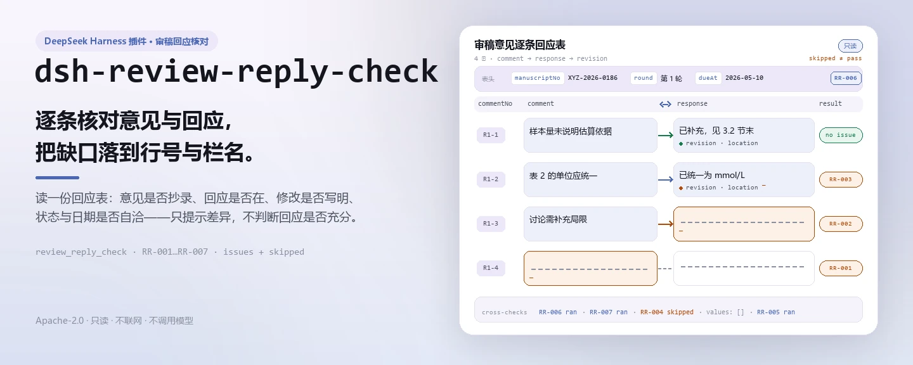
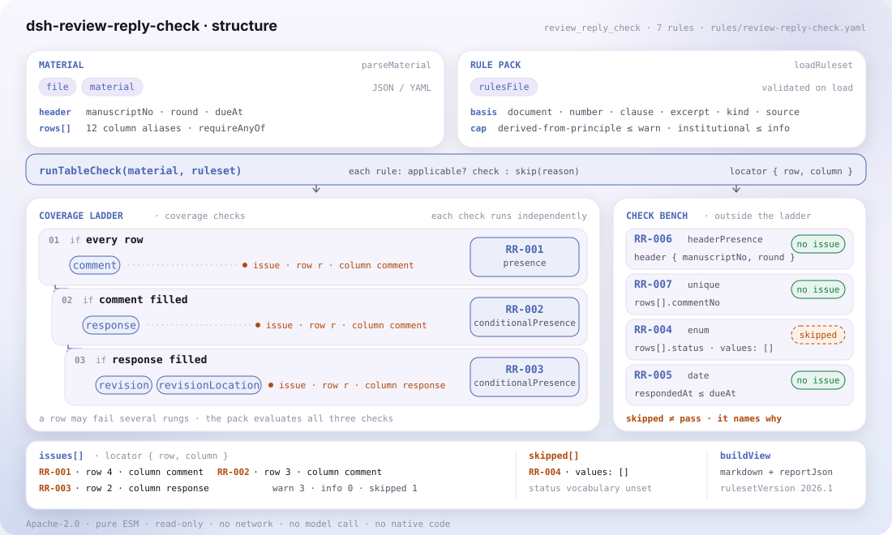

<div align="center">

<picture>
  <source media="(prefers-color-scheme: dark)" srcset="docs/assets/dsh-review-reply-check-hero-zh-dark.webp">
  
</picture>

# dsh-review-reply-check

**逐条核对审稿意见的回应覆盖与修改痕迹，把「哪一行、哪一栏、差什么」列成清单。**

面向期刊编辑的纯主机端核查插件：读取一份审稿意见逐条回应表，按版本化规则库核对覆盖完整性与留痕；不改原件、不联网、不调用模型，也不作合规或责任判断。

[安装](#三步上手) · [配置](#配置) · [FAQ](#faq) · [简体中文](README.md) · [English](README.en.md) · [Español](README.es.md) · [Português](README.pt.md) · [हिन्दी](README.hi.md)

[](LICENSE)
[](#兼容性)
[](https://www.npmjs.com/package/dsh-review-reply-check)
[](https://github.com/PerryLink/dsh-review-reply-check/actions/workflows/ci.yml)
[](#兼容性)

[](https://github.com/PerryLink/dsh-review-reply-check/stargazers)
[](https://www.npmjs.com/package/dsh-review-reply-check)
[](https://dshfind.com/plugins/PerryLink/dsh-review-reply-check?ref=badge)
[](https://securityscorecards.dev/viewer/?uri=github.com/PerryLink/dsh-review-reply-check)
[](https://dsh.market/)
[](https://gitee.com/perrylink/dsh-review-reply-check)

```sh
dsh plugin --profile <name> add dsh-review-reply-check
```

</div>

<sub>社区插件，与 DeepSeek 官方无关。唯一仓库：<https://github.com/PerryLink/dsh-review-reply-check>（Gitee 为镜像）。</sub>

## 它是什么

`dsh-review-reply-check` 读取一份审稿意见逐条回应表——稿件表头加每条意见一行——核对这份台账自身的覆盖完整性与留痕：每条意见的意见内容是否已抄录、凡填了意见内容的行是否都有作者回应、回应是否写明修改说明与修改位置、每行的处理状态是否取自你配置的状态口径、回应日期是否落在表内写明的返修期限之内、表头是否声明稿件编号与审稿轮次、意见序号是否重复。

它注册 `review_reply_check` 工具，按版本化规则库给出带 `locator` 的发现；无法执行的检查写进 `skipped` 并写明原因，绝不静默通过。纯主机端：不改原件、不联网、不调用模型，也不判断回应是否充分、修改是否到位或稿件是否应当录用。

<picture>
  <source media="(prefers-color-scheme: dark)" srcset="docs/assets/dsh-review-reply-check-flow-v5-dark.svg">
  
</picture>

## 三步上手

1. **安装**（三选一）：

   ```sh
   # git 通道（最新 main；等价于 git+https://github.com/PerryLink/dsh-review-reply-check.git）
   dsh plugin --profile web add github:PerryLink/dsh-review-reply-check
   # npm 通道（已发布版本）
   dsh plugin --profile web add dsh-review-reply-check
   # tarball 通道：本仓库 pnpm pack 后
   dsh plugin --profile web add ./dsh-review-reply-check-<version>.tgz
   ```

   发布包自带 `lib/`、`rules/`、`locale/` 与 `cordis.patch.yml`，安装即挂载。

2. **最小配置**（默认即可用；只改需要的键）：

   ```yaml
   - insert:
       - id: dsh-review-reply-check
         name: dsh-review-reply-check
         config:
           rulesFile: rules/review-reply-check.yaml
   ```

3. **验证已生效**：

   ```sh
   dsh --profile web --dump-config | grep 'dsh-review-reply-check'
   ```

   在仓库内试跑自带样例（先构建）：

   ```sh
   pnpm install && pnpm run build
   node samples/quickstart/run.mjs --check
   ```

   ```
   review_reply_check: 1 issue(s) — error 0, warn 1, info 0
   skipped: 2
   ```

   样例在 `samples/quickstart/input/`，期望输出在 `samples/quickstart/expected/result.json`；截图见 `docs/assets/quickstart.png`。

**卸载**：`dsh plugin --profile web remove dsh-review-reply-check`（或从 profile patch 删掉该行）。

## 核心能力

`review_reply_check` 只做一件事：把材料与规则库逐条比对，返回可定位的差异。它接收 `file` 或 `material`（JSON / YAML），以及可选的 `rulesFile` 与 `only`。

| 规则 | 核对什么 | 严重度 | 依据类型 |
|---|---|---|---|
| `RR-001` | 每条意见的意见内容是否已抄录 | warn | principle |
| `RR-002` | 凡填了意见内容的行是否都有作者回应 | warn | principle |
| `RR-003` | 有回应的行是否写明修改说明与修改位置 | warn | principle |
| `RR-004` | 处理状态是否取自你配置的状态口径（出厂不启用） | info | local |
| `RR-005` | 回应日期是否落在台账写明的返修期限之内 | info | local |
| `RR-006` | 表头是否声明稿件编号与审稿轮次 | warn | principle |
| `RR-007` | 意见序号是否在表内唯一 | warn | principle |

规则库是数据，不是代码：替换 `rules/*.yaml` 即可切换规则集，无需改 TypeScript。加载期强制校验每条规则的 `document` / `number` / `clause` / `excerpt` / `kind` / `source` 是否齐全，并把严重度封顶在依据允许的级别——原则性条款最多 `warn`，本机构配置最多 `info`。空的 issue 列表永远不能被读成「没有问题」：凡是无法执行的检查，都会写进 `skipped`。

## 它回答什么问题

下表是示例集：第一行是详细走查，其余行是简短案例。

本插件对自己 `RR-001` 测试夹具的**真实输出**，不是示意图。规则库不伪造引文，因此每条发现都会同时写明所引条款，以及该条款原文本次未取得。

### 详细输出

**工具** `review_reply_check`

**输入**

~~~json
{"manuscriptNo":"XYZ-2026-0186","title":"某某研究","rows":[{"序号":"R1-1","审稿人":"审稿人一","审稿意见":"","处理状态":"已修改"}]}
~~~

**输出**

~~~json
{
  "id": "dsh-review-reply-check.RR-001.de09b5a6",
  "ruleId": "RR-001",
  "severity": "warn",
  "locator": {
    "row": 1,
    "field": "comment"
  },
  "found": "第 1 行「comment」为空",
  "expected": "「comment」应填写",
  "fix": "补填审稿意见内容；本条只核对是否填写"
}
~~~

*来源 `dsh-review-reply-check/tests/fixtures/RR-001/RR-001-unsafe.json (cases.json expects 1×RR-001); executed parseMaterial+runCheck, checkedAt=2026-10-06T00:00:00.000Z`*

| 你会问 | 它怎么答 |
|---|---|
| 某行填了作者回应，但意见内容栏是空的。 | `RR-001` 要求每行都抄录意见内容：缺了它，回应就失去了对象，编辑也无从判断这条回应针对哪一条意见。本条只核对意见栏是否填写，不判断该意见是否成立、是否属于学术判断分歧。 |
| 意见已抄录，但作者回应栏还空着，会被报出吗？ | 会。`RR-002` 对凡是意见栏已填写的行都要求有回应——意见被略过与审稿人可接受的不同意是两件不同的事。它只核对回应栏是否填写，不判断回应是否充分、是否说服得了审稿人；确实无需修改的意见，规则库建议在回应栏写明理由，而不是留空。 |
| 回应里写了已修改，但修改说明栏与修改位置栏都是空的。 | `RR-003` 对凡是回应栏已填写的行，都要求同时填写 `revision` 与 `revisionLocation`。它只核对这两栏是否写明，不核对所写位置是否真有该处改动——本插件看不到稿件本身，一份把页码行号写得清清楚楚、却并无其事的修改说明同样会通过。 |
| 每行都填了处理状态，工具怎么判断这个取值行不行？ | `RR-004` 拿 `status` 栏的取值与你自己配置的清单比对。这份清单出厂为空，表示未配置，在你填入之前本条报告「无法执行」（`skipped`），而不是静默通过。它只核对所填值是否在册，不判断某一状态是否意味着该意见已被妥善处理。作为机构口径类规则，它的严重度封顶 `info`。 |
| 回应日期晚于表内写的返修期限，是不是就算逾期了？ | `RR-005` 拿 `respondedAt` 与台账自己写的 `dueAt` 相比，命中只表示「与你写在台账里的期限不一致」，不表示已经逾期——返修期限由各期刊规定，作者也可以申请延期。本插件不内置任何天数，也不替使用方推算：`dueAt` 为空时本条报告「无法执行」（`skipped`），不会假定任何期限。 |
| 两位审稿人的意见合并登记，序号都从 1 开始，于是同一个意见序号出现了两次。 | `RR-007` 会报出 `commentNo` 重复，因为序号重复会让覆盖率统计失真，也无法与审稿单上的编号对应。合并登记时把审稿人写进编号（如 `R1-3`、`R2-1`）即可保持唯一；本条只按填写的序号比较，不做合并、也不重新编号。 |

## 依据的标准

| 文件 | 文号 | 引用它的规则 |
|---|---|---|
| 《中国高校科技期刊编排规范》 | 现行版本与条号本次未核实 | RR-001, RR-002, RR-003, RR-006, RR-007 |
| 本期刊同行评议与返修规定（本机构配置） | 无统一标准（本条依据为本机构配置的状态口径） | RR-004 |
| 本期刊同行评议与返修规定（本机构配置） | 无统一标准（本条依据为台账写明的返修期限） | RR-005 |

规则库不伪造引文：本次核验未取得上述文件的逐字条文，因此每条规则的 `excerpt` 都写明这一缺口，严重度也相应封顶在 `warn` 或 `info`。

## 配置

全部可调参数都在 `src/config.ts` 的 Schemastery schema 中，只改 `cordis.yml` 即可生效，无需改代码；逐条阈值在 `rules/` 下的规则库文件里。按 id 覆盖会替换整行——请重述所有需要的键。

| 键 | 类型 | 默认值 | 说明 |
|---|---|---|---|
| `rulesFile` | string | `rules/review-reply-check.yaml` | 规则库文件路径，相对插件包根目录 |
| `disabledRules` | string[] | `[]` | 要停用的规则 id 列表；每条都会出现在 `skipped` 中 |
| `onlyRules` | string[] | `[]` | 只执行这些规则 id；留空表示执行全部规则 |
| `skipNotes` | string | `""` | 附加到每条 `skipped` 说明后的备注 |
| `timeoutMs` | number | `120000` | 工具协作式超时预算（毫秒） |

<details>
<summary>规则级参数</summary>

- `RR-004` 的 `values` —— 你的状态口径，例如 `[已修改, 部分修改, 不修改并说明理由, 已删除]`。出厂为空，表示不检查。
- `RR-005` 读取台账的 返修期限 / `dueAt` 栏。插件从不按天数推算期限。
- `RR-002` / `RR-003` 用 `conditionField` / `requiredFields` 决定何时要求哪些字段。
- `RR-007` 以意见序号栏为键；合并多位审稿人的意见时按审稿人编号（`R1-3`、`R2-1`），本条才能分辨。

</details>

profile patch 覆盖示例：

```yaml
- insert:
    - id: dsh-review-reply-check
      name: dsh-review-reply-check
      config:
        rulesFile: rules/review-reply-check.yaml
        onlyRules: [RR-001, RR-002, RR-003, RR-006, RR-007]
        timeoutMs: 120000
```

## 材料格式

支持 JSON 与 YAML：

```yaml
manuscriptNo: XYZ-2026-0186
title: 某某研究
journal: 某某学报
round: 第 1 轮
dueAt: 2026-05-10
rows:
  - { 序号: R1-1, 审稿人: 审稿人一, 意见类型: 方法, 指向位置: 第 3 节 3.2,
      审稿意见: 3.2 节的样本量未说明估算依据，请补充。,
      作者回应: 同意补充。已在 3.2 节末增加样本量估算说明，并引用既往研究作为依据。,
      修改说明: 新增一段样本量估算依据，引用两项既往研究并给出效应量假设。,
      修改位置: 第 8 页第 12—18 行（修订稿 3.2 节末）,
      处理状态: 已修改, 回应人: 通讯作者, 回应日期: 2026-05-06 }
```

栏名匹配不区分大小写，并忽略空格、下划线与连字符；表里写的是什么栏名就保留什么栏名，因此每条发现都会指名它读的是哪一栏。字段在读取层是可选的，由检查引擎校验，因此部分导出的材料会产生「缺项」类差异，而不是让程序崩溃。

## 规则来源

规则数据与代码分离，存放在 `rules/review-reply-check.yaml`。规则库头部写明引文缺口，每条规则的 `note` 重复与该条相关的那部分。加载期守卫通常强制「`excerpt` 必须是真实引文且不少于八个字符」，但它分辨不出一段引文与一段描述——因此这份规则库依靠头部说明、逐条 `note`，以及一个断言每个 `excerpt` 都承认该缺口的测试。

核验中确认的边界与「刻意没有作出的结论」见 `rules/evidence/`。**取得逐字条文后，把每个 `excerpt` 换成真实条款，并把 `kind` 提到 `direct`。**

## FAQ

<details>
<summary>材料会被传到模型或外网吗？数据存在哪？</summary>

不会。插件是纯主机端的只读核对：材料经 `file` 或 `material` 读入，只在内存中解析并交给 `runCheck`；不写回材料、不写临时文件、不发起网络请求、不调用模型——兼容性一节的「无联网、不调用模型」即指此事。报告只返回给当前会话。

</details>

<details>
<summary>空的问题清单是不是代表材料没问题？</summary>

不能这样读。每条无法执行的检查都会进入 `skipped` 并写明原因；规则库的红线是「空的 issue 列表永远不能被读成没有问题」。看报告时要同时看 `issueCount`、`skippedCount` 与 `summary`。

</details>

<details>
<summary>`RR-004` 为什么一直不运行？</summary>

它的 `values` 出厂为空，表示未配置，于是本条把自己记入 `skipped`，而不是静默通过。把本刊的处理状态口径填进 `values` 后它才会运行；它只核对取值是否在册，不判断某个状态是否意味着意见已被妥善处理。

</details>

<details>
<summary>`RR-005` 为什么报 `skipped`？</summary>

台账没有写返修期限（`dueAt` 为空）。插件不内置任何天数，也不替使用方推算期限；只有台账自己写明期限时，本条才比较回应日期。命中只表示「与你写在台账里的期限不一致」，从不表示「你逾期了」。

</details>

<details>
<summary>性能开销多大？会和别的插件冲突吗？</summary>

核对是纯函数：没有网络、没有模型调用，单次调用只在内存里读材料与规则库，不产生额外 I/O。插件只注册一个 `review_reply_check` 工具，不提供服务键、不注册客户端 slot、不注册 `webServer` 前缀，也不改全局对象。

</details>

## 安全边界

- **只读材料。** `file` 或 `material` 读入后只在内存中解析；插件不改写材料、不写临时文件，报告里的 `target` 只是读取位置。
- **不判定。** 只列材料与所引条款之间的字面差异，判定留给编辑；渲染层有措辞守卫，报告始终带免责声明。
- **看不到稿件。** `RR-003` 只核对修改说明与修改位置是否写明，不核对那处改动是否存在。
- **不内置期限与状态口径。** `RR-005` 只与台账写明的 `dueAt` 比对；`RR-004` 的 `values` 出厂为空。
- **不伪造引文。** 每个 `excerpt` 都明文写出条款原文本次未取得；加载期强制严重度不得超过依据允许的上限。
- **失败关闭。** 材料为空或格式不对时抛 `MaterialError`，不会产出空报告冒充通过。

**边界：** 本插件核对一份 **审稿意见逐条回应表** 的覆盖情况与证据——每条意见是否记录，每条意见是否带有作者回应，回应是否写明所做的修改及修改位置，处理状态是否取自你的取值口径，回应日期是否落在登记表写明的修回期限之内，表中是否写明稿件与审稿轮次，以及意见编号是否唯一。它**不**判定回应是否充分、修改是否到位，或稿件是否应当录用。

### ⚠️ 本插件能看到什么、不能看到什么（以英文原文为准）

> **它永远看不到稿件本身。** 它能核对的是回应是否写明了修改*发生在哪里*——但永远不能核对那处修改是否真的存在，也永远不能核对它是否回应了该条意见。`RR-003` 的 note 与排障一节都写明了这一点：一份语气笃定、位置写得一清二楚、却完全虚构的修改说明，照样能通过本插件。
>
> 「没有回应」与「不同意」之间的关系，正是 `RR-002` 的要旨：审稿人可以接受作者的不同意，却不能接受一条意见被默默略过，因此**覆盖**是返修质量最直接的指标。所以这条规则会在回应栏为空时触发——它的 note 还建议：当某条意见确实无需修改时，应写明理由，而不是把该栏留空。
>
> **插件不内置任何返修期限。** 各刊期限不同，作者也可能申请延期，因此 `RR-005` 拿回应日期与**台账中写明的期限**相比，并在该栏为空时把自己记入 `skipped`。一条发现意味着「这与你记录的期限不一致」，从不意味着「你逾期了」。状态取值清单同样因此出厂为**空**。
>
> **规则库中的每一个 `excerpt` 都明文写着：条款原文本次未取得。** 该制度见于 GB/T 7713.1（中国高校科技期刊编排规范）以及各刊的同行评议规则。核验环节无法取得逐字条款原文，因此规则库在 `excerpt` 字段本身写明这一缺口，并把每条规则保持在 `warn` 或 `info`。**待取得原文后，请把每个 `excerpt` 换成真实条款，并把 `kind` 提到 `direct`。**

## 已知限制

- **看不到稿件。** `RR-003` 只核对修改说明与修改位置是否填写，不核对改动是否存在；一份把页码行号写得清清楚楚、却完全虚构的修改说明照样通过。
- **不内置返修期限。** `RR-005` 只与台账自己写明的 `dueAt` 比对；该栏为空时报告 `skipped`，不会假定任何期限，也不会替你推算天数。
- **状态口径出厂为空。** `RR-004` 的 `values` 未配置时报告 `skipped`，而不是静默通过；填入本刊口径后它只核对取值是否在册。
- **引文缺口。** 本次核验未取得逐字条款原文，因此全部规则的依据类型为 `derived-from-principle` 或 `institutional-configuration`，严重度封顶 `warn` / `info`。
- **不做时区换算。** 全部计算都是对输入字符串做墙上时钟运算，时间看起来偏移时请检查材料里的日期写法。

## 排障

- **`RR-003` 通过了虚构的修改说明。** 它只核对修改位置是否写明，从不核对改动是否存在——比对需要稿件，而本插件看不到稿件。
- **`RR-002` 对一条我决定不回应的意见报错。** 请在回应栏写明理由。审稿人可以接受有理有据的不同意；空白栏会被读成「未处理」。
- **`RR-005` 报 `skipped`。** 台账没有写返修期限，插件不会凭空补一个。
- **`RR-004` 从不运行。** 它的取值清单是空的；填入本刊的处理状态即可。
- **`RR-007` 对不同审稿人的意见报重复。** 合并登记时按审稿人编号，表才不会产生歧义。
- **某条规则没有执行。** 查看 `skipped` 数组，其中写明了规则 id 与原因。
- **插件装上了但工具不出现。** 确认 `main` 指向 `lib/index.mjs` 且 `pnpm run build` 已生成该文件；`main` 写错会让加载器静默跳过该条目。
- **`dsh plugin add` 报版本不兼容。** peer 范围覆盖 `0.1.x` 与 `0.2.x`；若运行时在其之外，可显式豁免：`dsh plugin --profile <name> allow-version dsh-review-reply-check@0.1.0 --dsh-version <runtime> --accept-risk`
- **`check` 报 `manifest-peers` 失败。** 静态检查器比对的是一份早于 0.2 世代的硬编码 peer 范围；安装期的 peer 校验以运行时为准。这是 `dsh-plugin-dev` 的已知上游问题。
- **时间看起来偏移。** 全部计算都是对输入字符串做墙上时钟运算，不做时区换算。

## 兼容性

| 项目 | 状态 |
|---|---|
| Harness | 对等版本范围 `>=0.1.2-rc.1 <0.2.0 \|\| >=0.2.0-0 <0.3.0` —— 已实测同时接受 `0.2.0-rc.2` 与 `0.2.1-rc.2`。**已声明 `engines.dsh`**：0.2.1 起由宿主单独裁决，范围为 `>=0.2.1-0 <0.3.0` |
| Node | `^22.19.0 || >=24.0.0` |
| 平台 | 全平台（纯 ESM；无原生代码、无联网、不调用模型） |
| 工具模式 | `native` / `ptc` 均可；批量校验整个目录时建议 `ptc`，schema 成本只付一次 |

## 生态与质量

- [Gitee 镜像](https://gitee.com/perrylink/dsh-review-reply-check)（同步镜像，以 GitHub 为准）
- [dshfind 插件页](https://dshfind.com/plugins/PerryLink/dsh-review-reply-check)（安装量与排名）
- [OpenSSF Scorecard 报告](https://securityscorecards.dev/viewer/?uri=github.com/PerryLink/dsh-review-reply-check)（由 [.github/workflows/scorecard.yml](.github/workflows/scorecard.yml) 驱动）
- [DSH Market](https://dsh.market/)（已上架）
- [生态实测知识库](https://perrylink.github.io/dsh-plugin-guide/)：插件开发指南 · 选型实测数据 · 维护取舍判据
- [按材料选核查器](https://perrylink.github.io/zh/checkers/choose/)（家族索引）

## 开发

```sh
pnpm install
pnpm run typecheck        # tsc --noEmit
pnpm test                 # vitest：共享表格插件套件 + 成对夹具
pnpm run build            # tsdown -> lib/index.mjs + lib/index.d.mts
pnpm run verify:self-contained
pnpm run check:lockfile
pnpm run check:readmes    # README 一致性
pnpm run check:citations
node ../scripts/sync-shared.mjs dsh-review-reply-check   # 刷新 src/shared（来自 ../_shared）
pnpm pack
```

插件是**纯数据驱动**的：`src/model.ts` 声明表格形状，共享套件提供读取器与检查引擎，规则库声明每一条检查。`src/shared/` 是从 `../_shared` 复制进来的共享件，不是外部依赖——每次改动共享件后都要重跑上面的同步命令。

配图由 [`scripts/gen-readme-assets.py`](scripts/gen-readme-assets.py) 程序化生成（Python + Pillow），可重复执行：`python scripts/gen-readme-assets.py`。

## 家族与致谢

本项目是 [PerryLink](https://github.com/PerryLink) 维护的 DeepSeek Harness 插件家族成员（全部 Apache-2.0）。如果这个插件帮到了你，**给个 star**——它不解锁任何功能，但会让下一个人更容易找到它。

- [@PerryLink](https://github.com/PerryLink) —— 创建者与维护者：审稿意见回应覆盖规则库、`review_reply_check` 工具、五语文档。

<details>
<summary>展开全部插件</summary>

| 插件 | 状态 |
|---|---|
| **[dsh-aqua-input-check](https://github.com/PerryLink/dsh-aqua-input-check)** |  |
| **[dsh-archive-check](https://github.com/PerryLink/dsh-archive-check)** |  |
| **[dsh-auto-review](https://github.com/PerryLink/dsh-auto-review)** |  |
| **[dsh-autotier](https://github.com/PerryLink/dsh-autotier)** | 🧊 已冻结 — 见仓库 README |
| **[dsh-bid-ca-precheck](https://github.com/PerryLink/dsh-bid-ca-precheck)** |  |
| **[dsh-bid-qual-check](https://github.com/PerryLink/dsh-bid-qual-check)** |  |
| **[dsh-cert-mcp](https://github.com/PerryLink/dsh-cert-mcp)** | 🧊 已冻结 — 见仓库 README |
| **[dsh-checkpoint-rewind](https://github.com/PerryLink/dsh-checkpoint-rewind)** |  |
| **[dsh-click](https://github.com/PerryLink/dsh-click)** |  |
| **[dsh-composer-history](https://github.com/PerryLink/dsh-composer-history)** |  |
| **[dsh-contract-stance](https://github.com/PerryLink/dsh-contract-stance)** |  |
| **[dsh-customs-doc-check](https://github.com/PerryLink/dsh-customs-doc-check)** |  |
| **[dsh-data-quality](https://github.com/PerryLink/dsh-data-quality)** | 🧊 已冻结 — 见仓库 README |
| **[dsh-demurrage-ledger](https://github.com/PerryLink/dsh-demurrage-ledger)** |  |
| **[dsh-doublecheck](https://github.com/PerryLink/dsh-doublecheck)** |  |
| **[dsh-drill-script-check](https://github.com/PerryLink/dsh-drill-script-check)** |  |
| **[dsh-eia-guide-check](https://github.com/PerryLink/dsh-eia-guide-check)** |  |
| **[dsh-emergency-plan](https://github.com/PerryLink/dsh-emergency-plan)** |  |
| **[dsh-essay-rubric-check](https://github.com/PerryLink/dsh-essay-rubric-check)** |  |
| **[dsh-evidence-check](https://github.com/PerryLink/dsh-evidence-check)** |  |
| **[dsh-export-ctl-check](https://github.com/PerryLink/dsh-export-ctl-check)** |  |
| **[dsh-fast](https://github.com/PerryLink/dsh-fast)** |  |
| **[dsh-fmea-table-check](https://github.com/PerryLink/dsh-fmea-table-check)** |  |
| **[dsh-forecast-penalty](https://github.com/PerryLink/dsh-forecast-penalty)** |  |
| **[dsh-fund-research](https://github.com/PerryLink/dsh-fund-research)** |  |
| **[dsh-github](https://github.com/PerryLink/dsh-github)** |  |
| **[dsh-gongwen-flow-check](https://github.com/PerryLink/dsh-gongwen-flow-check)** |  |
| **[dsh-gongwen-word-check](https://github.com/PerryLink/dsh-gongwen-word-check)** |  |
| **[dsh-guard-plan-qc](https://github.com/PerryLink/dsh-guard-plan-qc)** |  |
| **[dsh-hazchem-check](https://github.com/PerryLink/dsh-hazchem-check)** |  |
| **[dsh-hazplan-check](https://github.com/PerryLink/dsh-hazplan-check)** |  |
| **[dsh-hidden-risk-map](https://github.com/PerryLink/dsh-hidden-risk-map)** |  |
| **[dsh-hs-classify](https://github.com/PerryLink/dsh-hs-classify)** |  |
| **[dsh-icd-rule-check](https://github.com/PerryLink/dsh-icd-rule-check)** |  |
| **[dsh-industry-research](https://github.com/PerryLink/dsh-industry-research)** |  |
| **[dsh-lawcite-adapter](https://github.com/PerryLink/dsh-lawcite-adapter)** |  |
| **[dsh-laya](https://github.com/PerryLink/dsh-laya)** |  |
| **[dsh-lc-doc-check](https://github.com/PerryLink/dsh-lc-doc-check)** |  |
| **[dsh-learning-gap-check](https://github.com/PerryLink/dsh-learning-gap-check)** |  |
| **[dsh-library](https://github.com/PerryLink/dsh-library)** |  |
| **[dsh-local-ai](https://github.com/PerryLink/dsh-local-ai)** |  |
| **[dsh-lsp-actions](https://github.com/PerryLink/dsh-lsp-actions)** |  |
| **[dsh-mask](https://github.com/PerryLink/dsh-mask)** |  |
| **[dsh-mcp-panel](https://github.com/PerryLink/dsh-mcp-panel)** |  |
| **[dsh-medrec-qc](https://github.com/PerryLink/dsh-medrec-qc)** |  |
| **[dsh-memento](https://github.com/PerryLink/dsh-memento)** | 🧊 已冻结 — 见仓库 README |
| **[dsh-nsfc-form-check](https://github.com/PerryLink/dsh-nsfc-form-check)** |  |
| **[dsh-nurse-record-check](https://github.com/PerryLink/dsh-nurse-record-check)** |  |
| **[dsh-observe](https://github.com/PerryLink/dsh-observe)** |  |
| **[dsh-origin-rvc-check](https://github.com/PerryLink/dsh-origin-rvc-check)** |  |
| **[dsh-ota-review-check](https://github.com/PerryLink/dsh-ota-review-check)** |  |
| **[dsh-output-styles](https://github.com/PerryLink/dsh-output-styles)** |  |
| **[dsh-paper-doc-adapter](https://github.com/PerryLink/dsh-paper-doc-adapter)** |  |
| **[dsh-permission-rules](https://github.com/PerryLink/dsh-permission-rules)** |  |
| **[dsh-permit-report-check](https://github.com/PerryLink/dsh-permit-report-check)** |  |
| **[dsh-pipeline-check](https://github.com/PerryLink/dsh-pipeline-check)** |  |
| **[dsh-pleading-draft](https://github.com/PerryLink/dsh-pleading-draft)** |  |
| **[dsh-plugin-doctor](https://github.com/PerryLink/dsh-plugin-doctor)** | 🚫 已退役（仓库已归档） |
| **[dsh-plugin-guide](https://github.com/PerryLink/dsh-plugin-guide)** |  |
| **[dsh-plugin-kit](https://github.com/PerryLink/dsh-plugin-kit)** | 🚫 已退役（仓库已归档） |
| **[dsh-plugin-upgrade](https://github.com/PerryLink/dsh-plugin-upgrade)** | 🚫 已退役（仓库已归档） |
| **[dsh-policy-brief-draft](https://github.com/PerryLink/dsh-policy-brief-draft)** |  |
| **[dsh-power-loss-split](https://github.com/PerryLink/dsh-power-loss-split)** |  |
| **[dsh-power-ticket-check](https://github.com/PerryLink/dsh-power-ticket-check)** |  |
| **[dsh-ppap-check](https://github.com/PerryLink/dsh-ppap-check)** |  |
| **[dsh-protest-deadline](https://github.com/PerryLink/dsh-protest-deadline)** |  |
| **[dsh-railway-window](https://github.com/PerryLink/dsh-railway-window)** |  |
| **[dsh-repair-order-qc](https://github.com/PerryLink/dsh-repair-order-qc)** |  |
| **[dsh-research-report](https://github.com/PerryLink/dsh-research-report)** |  |
| **[dsh-review-reply-check](https://github.com/PerryLink/dsh-review-reply-check)** |  |
| **[dsh-rulefile-check](https://github.com/PerryLink/dsh-rulefile-check)** |  |
| **[dsh-safety-brief-check](https://github.com/PerryLink/dsh-safety-brief-check)** |  |
| **[dsh-score](https://github.com/PerryLink/dsh-score)** | 🧊 已冻结 — 见仓库 README |
| **[dsh-session-sync](https://github.com/PerryLink/dsh-session-sync)** |  |
| **[dsh-site-log-check](https://github.com/PerryLink/dsh-site-log-check)** |  |
| **[dsh-skill-pack-security](https://github.com/PerryLink/dsh-skill-pack-security)** |  |
| **[dsh-soe-decision-check](https://github.com/PerryLink/dsh-soe-decision-check)** |  |
| **[dsh-soilwater-check](https://github.com/PerryLink/dsh-soilwater-check)** |  |
| **[dsh-sop-sync-check](https://github.com/PerryLink/dsh-sop-sync-check)** |  |
| **[dsh-spc-gbt-adapter](https://github.com/PerryLink/dsh-spc-gbt-adapter)** |  |
| **[dsh-talk](https://github.com/PerryLink/dsh-talk)** |  |
| **[dsh-tender-extract](https://github.com/PerryLink/dsh-tender-extract)** |  |
| **[dsh-tender-matrix](https://github.com/PerryLink/dsh-tender-matrix)** |  |
| **[dsh-test-drive](https://github.com/PerryLink/dsh-test-drive)** |  |
| **[dsh-ticktick](https://github.com/PerryLink/dsh-ticktick)** | 🚫 已退役（仓库已归档） |
| **[dsh-translate](https://github.com/PerryLink/dsh-translate)** |  |
| **[dsh-warranty-calc](https://github.com/PerryLink/dsh-warranty-calc)** |  |
| **[dsh-budget](https://github.com/PerryLink/dsh-budget)** | 🧊 已冻结 — 见仓库 README |
| **[dsh-claude-move](https://github.com/PerryLink/dsh-claude-move)** | 🧊 已冻结 — 见仓库 README |
| **[dsh-defend](https://github.com/PerryLink/dsh-defend)** | 🧊 已冻结 — 见仓库 README |
| **[dsh-draw](https://github.com/PerryLink/dsh-draw)** | 🧊 已冻结 — 见仓库 README |
| **[dsh-reach](https://github.com/PerryLink/dsh-reach)** | 🧊 已冻结 — 见仓库 README |
| **[dsh-background-agents](https://github.com/PerryLink/dsh-background-agents)** | 🚫 已退役（仓库已归档） |
| **[dsh-session-pin](https://github.com/PerryLink/dsh-session-pin)** | 🚫 已退役（仓库已归档） |
| **[dsh-team-rooms](https://github.com/PerryLink/dsh-team-rooms)** | 🚫 已退役（仓库已归档） |

</details>

## License

[LICENSE](LICENSE)（Apache License 2.0）© 2026 dsh-review-reply-check contributors

<p align="center"><sub>Apache-2.0 · 社区插件，与 DeepSeek 无关。</sub></p>
