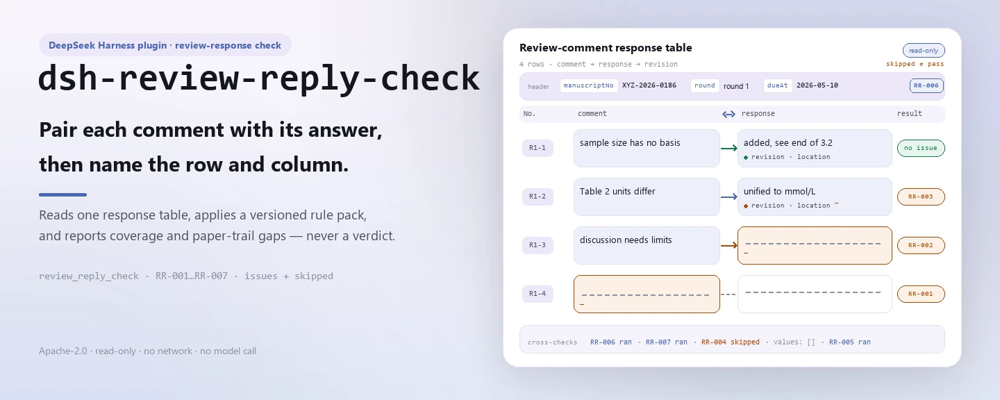
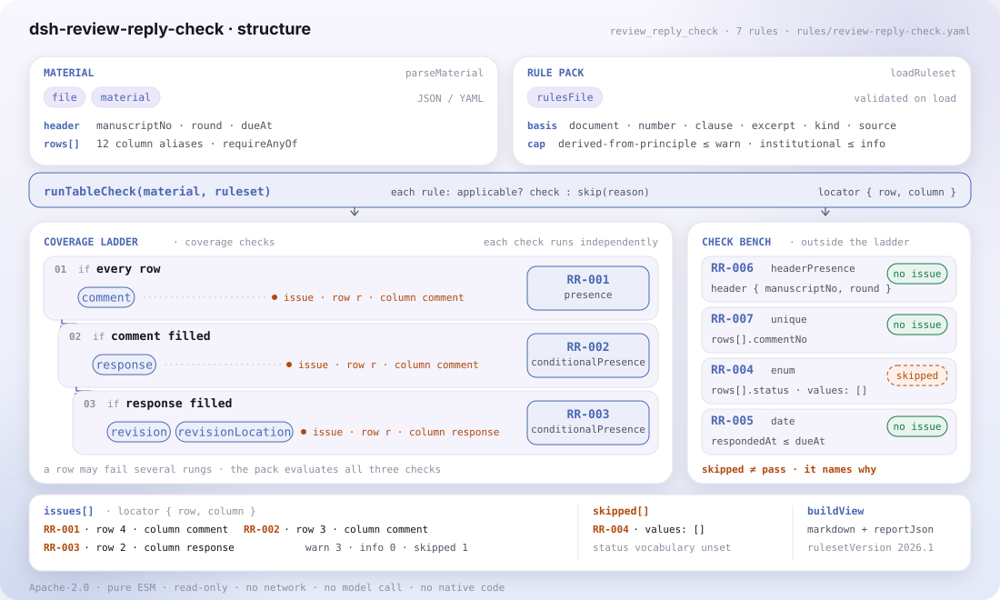

<div align="center">

<picture>
  <source media="(prefers-color-scheme: dark)" srcset="docs/assets/dsh-review-reply-check-hero-en-dark.webp">
  
</picture>

# dsh-review-reply-check

**Garanta que cada comentário de revisão receba resposta — e que o rastro documental diga o que mudou e onde.**

Um verificador puramente local para editores de periódicos: lê uma tabela de respostas aos comentários de revisão, aplica um pacote de regras versionado e aponta lacunas de cobertura e de rastro documental — sem alterar o original, sem rede, sem chamadas ao modelo e sem emitir veredito.

[Instalação](#instalação-em-três-passos) · [Configuração](#configuração) · [FAQ](#faq) · [简体中文](README.md) · [English](README.en.md) · [Español](README.es.md) · [Português](README.pt.md) · [हिन्दी](README.hi.md)

[](LICENSE)
[](#compatibilidade)
[](https://www.npmjs.com/package/dsh-review-reply-check)
[](https://github.com/PerryLink/dsh-review-reply-check/actions/workflows/ci.yml)
[](#compatibilidade)

[](https://github.com/PerryLink/dsh-review-reply-check/stargazers)
[](https://www.npmjs.com/package/dsh-review-reply-check)
[](https://dshfind.com/plugins/PerryLink/dsh-review-reply-check?ref=badge)
[](https://securityscorecards.dev/viewer/?uri=github.com/PerryLink/dsh-review-reply-check)
[](https://dsh.market/)
[](https://gitee.com/perrylink/dsh-review-reply-check)

```sh
dsh plugin --profile <name> add dsh-review-reply-check
```

</div>

<sub>Complemento da comunidade, sem vínculo com a DeepSeek. Repositório canônico: <https://github.com/PerryLink/dsh-review-reply-check> (o Gitee é um espelho).</sub>

## O que é

`dsh-review-reply-check` lê uma tabela de respostas aos comentários de revisão —o cabeçalho do manuscrito mais uma linha por comentário— e verifica a cobertura e o rastro documental dessa própria tabela: que o texto de cada comentário esteja registado, que toda linha com comentário preenchido traga resposta do autor, que a resposta indique a alteração feita e onde foi feita, que cada estado de tratamento venha do vocabulário que você configurar, que as datas de resposta caiam dentro do prazo de revisão que a própria tabela declara, que o cabeçalho declare o seu manuscrito e a sua ronda de revisão, e que os números de comentário não se repitam.

Registra a ferramenta `review_reply_check` e devolve achados com `locator` segundo um pacote de regras versionado; as verificações que não podem correr são escritas em `skipped` com o motivo, nunca passam em silêncio. Tudo acontece no host: o original não é alterado, não há rede, não se chama qualquer modelo e o plugin não decide se uma resposta é suficiente, se a revisão está bem feita ou se o manuscrito deve ser aceito.

<picture>
  <source media="(prefers-color-scheme: dark)" srcset="docs/assets/dsh-review-reply-check-flow-v5-dark.svg">
  
</picture>

## Instalação em três passos

1. **Instalar** (escolha um canal):

   ```sh
   # canal git (main mais recente; equivale a git+https://github.com/PerryLink/dsh-review-reply-check.git)
   dsh plugin --profile web add github:PerryLink/dsh-review-reply-check
   # canal npm (versões publicadas)
   dsh plugin --profile web add dsh-review-reply-check
   # canal tarball: pnpm pack neste repositório e depois
   dsh plugin --profile web add ./dsh-review-reply-check-<version>.tgz
   ```

   O pacote publicado inclui `lib/`, `rules/`, `locale/` e `cordis.patch.yml`, portanto instalar é tudo o que é preciso.

2. **Configuração mínima** (os padrões servem; mude só as chaves necessárias):

   ```yaml
   - insert:
       - id: dsh-review-reply-check
         name: dsh-review-reply-check
         config:
           rulesFile: rules/review-reply-check.yaml
   ```

3. **Confirmar que montou**:

   ```sh
   dsh --profile web --dump-config | grep 'dsh-review-reply-check'
   ```

   Execute o exemplo incluído a partir do repositório (compile primeiro):

   ```sh
   pnpm install && pnpm run build
   node samples/quickstart/run.mjs --check
   ```

   ```
   review_reply_check: 1 issue(s) — error 0, warn 1, info 0
   skipped: 2
   ```

   O exemplo está em `samples/quickstart/input/`, a saída esperada em `samples/quickstart/expected/result.json` e a captura em `docs/assets/quickstart.png`.

**Desinstalar**: `dsh plugin --profile web remove dsh-review-reply-check` (ou remova a linha do patch do perfil).

## Capacidades principais

`review_reply_check` faz uma coisa só: compara o material com o pacote de regras e devolve diferenças localizáveis. Aceita `file` ou `material` (JSON / YAML), além de `rulesFile` e `only` opcionais.

| Regra | O que verifica | Severidade | Tipo de base |
|---|---|---|---|
| `RR-001` | o texto de cada comentário está registado | warn | principle |
| `RR-002` | todo comentário traz resposta | warn | principle |
| `RR-003` | a resposta indica a alteração e o local | warn | principle |
| `RR-004` | o estado vem do seu vocabulário (desativada por padrão) | info | local |
| `RR-005` | a data de resposta cai dentro do prazo registado | info | local |
| `RR-006` | a folha nomeia o manuscrito e a ronda | warn | principle |
| `RR-007` | os números de comentário são únicos | warn | principle |

O pacote de regras é dados, não código: substituir `rules/*.yaml` troca o conjunto de regras sem tocar em TypeScript. Na carga, cada regra é validada quanto a `document` / `number` / `clause` / `excerpt` / `kind` / `source`, e a severidade fica limitada pela base: uma regra derivada de princípio não passa de `warn`, uma de configuração institucional não passa de `info`. Uma lista de problemas vazia nunca pode ser lida como «não há nada errado»: toda verificação que não pôde correr é escrita em `skipped`.

## O que ele responde

A tabela abaixo é o conjunto de exemplos: a primeira linha é o caso detalhado e as demais são casos curtos.

Esta é a saída real do plugin sobre o seu próprio fixture de teste `RR-001`, não é uma simulação. O pacote de regras não inventa citações, por isso cada achado nomeia a cláusula aplicada e avisa que o seu texto não foi obtido.

### Saída detalhada

**Ferramenta** `review_reply_check`

**Entrada**

~~~json
{"manuscriptNo":"XYZ-2026-0186","title":"某某研究","rows":[{"序号":"R1-1","审稿人":"审稿人一","审稿意见":"","处理状态":"已修改"}]}
~~~

**Saída**

~~~json
{
  "id": "dsh-review-reply-check.RR-001.de09b5a6",
  "ruleId": "RR-001",
  "severity": "warn",
  "locator": {
    "row": 1,
    "field": "comment"
  },
  "found": "第 1 行「comment」为空",
  "expected": "「comment」应填写",
  "fix": "补填审稿意见内容；本条只核对是否填写"
}
~~~

*Observado em `dsh-review-reply-check/tests/fixtures/RR-001/RR-001-unsafe.json (cases.json expects 1×RR-001); executed parseMaterial+runCheck, checkedAt=2026-10-06T00:00:00.000Z`*

| Você pergunta | O que ele responde |
|---|---|
| Uma linha traz a resposta do autor, mas a célula com o texto do comentário está vazia. | `RR-001` exige o texto do comentário em cada linha: sem ele a resposta fica sem objeto e o editor não consegue ver a que comentário corresponde. A regra verifica apenas se a célula está preenchida; não julga se o comentário procede nem se é uma divergência de juízo académico. |
| O comentário está registado, mas a célula de resposta do autor continua vazia — isso é reportado? | Sim. `RR-002` exige uma resposta em toda linha cujo comentário esteja preenchido, porque um comentário ignorado não é o mesmo que uma discordância que o revisor pode avaliar. Verifica apenas se a célula de resposta está preenchida, não se a resposta é suficiente ou convincente; quando um comentário realmente não exigir alterações, o pacote aconselha escrever o motivo nessa célula em vez de a deixar vazia. |
| A resposta diz que o texto foi alterado, mas a nota de revisão e a coluna de localização estão vazias. | `RR-003` exige `revision` e `revisionLocation` em toda linha cujo campo `response` esteja preenchido. Verifica que as duas células estejam escritas, não que a alteração esteja onde elas dizem: o plugin nunca vê o manuscrito, pelo que uma nota de revisão com página e linha precisas a descrever uma alteração inexistente também passa. |
| Todas as linhas trazem um estado de tratamento. Como decide a ferramenta se o valor serve? | `RR-004` compara o valor da coluna `status` com a lista que você configurar. Essa lista vem vazia, ou seja, por configurar, pelo que até a preencher a regra reporta-se em `skipped` em vez de passar em silêncio. Verifica apenas se o valor consta da sua lista; não decide se um dado estado significa que o comentário foi bem atendido. Sendo regra de configuração institucional, a sua severidade está limitada a `info`. |
| A data de resposta é posterior à coluna do prazo — isso significa que a revisão chegou tarde? | `RR-005` compara `respondedAt` com o `dueAt` que a própria tabela escreve, e um achado significa apenas que ambos não concordam com o prazo que você registou, não que a revisão tenha chegado tarde, porque os prazos variam com a revista e o autor pode pedir prorrogação. Não há qualquer número de dias incorporado nem nada é calculado: quando `dueAt` está vazio a regra reporta-se em `skipped` em vez de presumir um prazo. |
| Os comentários de dois revisores foram registados juntos e ambos numeram a partir de 1, pelo que um número de comentário aparece duas vezes. | `RR-007` reporta um valor repetido em `commentNo`, porque um duplicado distorce a contagem da cobertura e quebra a correspondência com o formulário de revisão. Registá-los com uma numeração que inclua o revisor —`R1-3`, `R2-1`— mantém-nos únicos; a regra compara os números tal como estão escritos e não funde nem renumera nada. |

## Normas que segue

| Documento | Número | Regras que o citam |
|---|---|---|
| Norma de composição de periódicos científicos e tecnológicos universitários chineses | Versão em vigor e número de cláusula não verificados nesta passagem | RR-001, RR-002, RR-003, RR-006, RR-007 |
| Normas de revisão por pares e correção deste periódico (configuração institucional) | Sem norma uniforme (esta regra baseia-se no vocabulário de estados da instituição) | RR-004 |
| Normas de revisão por pares e correção deste periódico (configuração institucional) | Sem norma uniforme (esta regra baseia-se no prazo registado na tabela) | RR-005 |

O pacote de regras não inventa citações: esta verificação não obteve o texto literal das cláusulas, por isso o `excerpt` de cada regra declara essa lacuna e a sua severidade fica limitada a `warn` ou `info`.

## Configuração

Todos os parâmetros ajustáveis ficam no esquema Schemastery de `src/config.ts`, portanto mudam pelo `cordis.yml` sem editar código; os limites por regra ficam no pacote de regras sob `rules/`. Uma substituição dirigida por id substitui a linha inteira: volte a declarar todas as chaves de que precisa.

| Chave | Tipo | Padrão | Descrição |
|---|---|---|---|
| `rulesFile` | string | `rules/review-reply-check.yaml` | Caminho do pacote de regras, relativo à raiz do pacote |
| `disabledRules` | string[] | `[]` | Ids de regras a desativar; cada uma aparece em `skipped` |
| `onlyRules` | string[] | `[]` | Executar apenas estas regras; vazio executa todas |
| `skipNotes` | string | `""` | Nota acrescentada a cada motivo de `skipped` |
| `timeoutMs` | number | `120000` | Orçamento de tempo limite cooperativo da ferramenta |

<details>
<summary>Parâmetros por regra</summary>

- `RR-004` `values` — o seu vocabulário de estados, p. ex. `[alterado, alterado parcialmente, não alterado com justificativa, removido]`. Vazio significa que não se verifica.
- `RR-005` lê a coluna do prazo de revisão / `dueAt` da tabela. O plugin nunca deduz um prazo a partir de um número de dias.
- `RR-002` e `RR-003` usam `conditionField` / `requiredFields` — o que aciona cada exigência.
- `RR-007` baseia-se na coluna do número de comentário. Quando se fundem comentários de vários revisores, numere-os por revisor (`R1-3`, `R2-1`) para que a regra os distinga.

</details>

Exemplo de substituição no patch do perfil:

```yaml
- insert:
    - id: dsh-review-reply-check
      name: dsh-review-reply-check
      config:
        rulesFile: rules/review-reply-check.yaml
        onlyRules: [RR-001, RR-002, RR-003, RR-006, RR-007]
        timeoutMs: 120000
```

## Formato do material

Aceita JSON ou YAML:

```yaml
manuscriptNo: XYZ-2026-0186
title: 某某研究
journal: 某某学报
round: 第 1 轮
dueAt: 2026-05-10
rows:
  - { 序号: R1-1, 审稿人: 审稿人一, 意见类型: 方法, 指向位置: 第 3 节 3.2,
      审稿意见: 3.2 节的样本量未说明估算依据，请补充。,
      作者回应: 同意补充。已在 3.2 节末增加样本量估算说明，并引用既往研究作为依据。,
      修改说明: 新增一段样本量估算依据，引用两项既往研究并给出效应量假设。,
      修改位置: 第 8 页第 12—18 行（修订稿 3.2 节末）,
      处理状态: 已修改, 回应人: 通讯作者, 回应日期: 2026-05-06 }
```

Os nomes de coluna são comparados sem distinguir maiúsculas e ignorando espaços, sublinhados e hífenes; os nomes próprios da tabela são preservados, pelo que cada achado nomeia a coluna que leu. Os campos são opcionais na camada de leitura e validados pelo motor, de modo que uma exportação parcial gera achados de «falta um dado» em vez de falhar.

## Origem das regras

Os dados das regras ficam separados do código e vivem em `rules/review-reply-check.yaml`. O cabeçalho do pacote declara a lacuna de citações por inteiro, e a `note` de cada regra repete a parte que lhe diz respeito. A guarda de carga que normalmente exige «um `excerpt` tem de ser uma citação real de pelo menos oito caracteres» não distingue uma citação de uma descrição; por isso este pacote apoia-se no cabeçalho, nas notas por regra e num teste que afirma que cada `excerpt` reconhece a lacuna.

Os limites verificados e as conclusões deliberadamente **não** afirmadas estão em `rules/evidence/`. **Quando tiver os textos, substitua cada `excerpt` pela cláusula real e suba `kind` para `direct`.**

## FAQ

<details>
<summary>O material chega a um modelo ou à rede? Onde ficam os dados?</summary>

Não. O verificador é de leitura apenas e corre no host: o material entra por `file` ou `material`, é analisado em memória e entregue a `runCheck`; nada é escrito de volta, não se criam ficheiros temporários, não há pedidos de rede nem chamadas ao modelo — é isso que «sem rede, sem chamada ao modelo» significa em Compatibilidade. O relatório só volta à sessão atual.

</details>

<details>
<summary>Uma lista de problemas vazia significa que o material está bem?</summary>

Não. Toda verificação que não pôde correr é escrita em `skipped` com o motivo; a linha vermelha do pacote é que uma lista de problemas vazia nunca pode ser lida como «não há nada errado». Leia `issueCount`, `skippedCount` e `summary` em conjunto.

</details>

<details>
<summary>Porque é que `RR-004` nunca corre?</summary>

A lista `values` vem vazia, ou seja, por configurar, pelo que a regra se reporta em `skipped` em vez de passar em silêncio. Só corre depois de preencher o vocabulário de estados do seu periódico; mesmo então verifica a pertença à sua lista, não se um estado significa que o comentário foi bem atendido.

</details>

<details>
<summary>Porque é que `RR-005` aparece em `skipped`?</summary>

A tabela não regista prazo de revisão (`dueAt` está vazio). Não há qualquer número de dias incorporado nem se deduz um prazo; a regra compara datas de resposta apenas quando a própria tabela declara o prazo. Um achado significa «isto não concorda com o prazo que você registou», nunca «chegou tarde».

</details>

<details>
<summary>Qual é o custo de execução? Choca com outros plugins?</summary>

A verificação é uma função pura: sem rede, sem chamada ao modelo, lendo o material e o pacote de regras em memória sem E/S adicional. O plugin regista exatamente uma ferramenta, `review_reply_check`; não fornece qualquer chave de serviço, não regista slots de cliente nem prefixos `webServer`, e não altera objetos globais.

</details>

## Limites de segurança

- **Material só de leitura.** `file` ou `material` é analisado em memória; o plugin nunca reescreve o material, não cria ficheiros temporários e o `target` do relatório é apenas o local de leitura.
- **Sem veredito.** Enumera diferenças literais face às cláusulas citadas e deixa a decisão ao editor; uma guarda de redação e um aviso em cada relatório garantem-no.
- **Nunca vê o manuscrito.** `RR-003` verifica que a nota de revisão e a localização estão escritas, nunca que a alteração existe.
- **Sem prazo nem vocabulário incorporados.** `RR-005` compara apenas com o `dueAt` da tabela; os `values` de `RR-004` vêm vazios.
- **Sem citações inventadas.** Cada `excerpt` diz com todas as letras que o texto da cláusula não foi obtido; a validação de carga recusa uma severidade acima do limite da base.
- **Falha fechada.** Material vazio ou malformado lança `MaterialError`; o plugin nunca emite um relatório vazio que possa passar por aprovado.

**Limite:** este plugin verifica uma **tabela de respostas aos comentários de revisão** quanto a cobertura e evidência — que cada comentário esteja registado, que cada comentário traga resposta do autor, que a resposta indique a alteração feita e onde foi feita, que o estado de tratamento venha do seu vocabulário, que as datas de resposta caiam dentro do prazo que a tabela declara, que a folha nomeie o manuscrito e a ronda de revisão, e que os números de comentário sejam únicos. **Não** decide se uma resposta é suficiente, se a revisão está bem feita ou se o manuscrito deve ser aceito.

### ⚠️ O que este plugin pode e não pode ver

> **Nunca vê o manuscrito.** Pode verificar que uma resposta diga *onde* foi feita uma alteração — nunca que a alteração esteja lá, nem que responda ao comentário. A nota de `RR-003` e a secção de solução de problemas dizem-no: uma nota de revisão segura, bem localizada e completamente fictícia passa neste plugin.
>
> A relação entre «sem resposta» e «discordância» é o ponto de `RR-002`: um revisor pode aceitar a discordância de um autor, mas não um comentário ignorado em silêncio, por isso a **cobertura** é o indicador mais direto da qualidade da revisão. A regra dispara, portanto, na célula de resposta vazia — e a sua nota aconselha registar o motivo em vez de deixar a célula vazia quando um comentário realmente não precisa de alterações.
>
> **Não há qualquer prazo de revisão incorporado.** Os prazos variam com o periódico e os autores podem pedir prorrogação, por isso `RR-005` compara a data de resposta com o **prazo escrito na tabela** e reporta-se em `skipped` quando essa coluna está vazia. Um achado significa «isto não concorda com o prazo que você registou», nunca «chegou tarde». O vocabulário de estados também é entregue **vazio** pela mesma razão.
>
> **Cada `excerpt` do pacote de regras diz, por palavras expressas, que o texto da cláusula não foi obtido.** O regime está na GB/T 7713.1, a norma chinesa de edição de periódicos universitários, e nas regras de revisão por pares de cada periódico. A verificação não conseguiu recuperar o texto literal, por isso o pacote declara a lacuna no próprio campo `excerpt` e mantém cada regra em `warn` ou `info`. **Quando tiver os textos, substitua cada `excerpt` pela cláusula real e suba `kind` para `direct`.**

## Limitações conhecidas

- **Nunca vê o manuscrito.** `RR-003` verifica que a nota de revisão e a localização estão escritas, não que a alteração existe; uma nota precisa que descreve uma alteração que nunca foi feita também passa.
- **Sem prazo de revisão incorporado.** `RR-005` compara apenas com o `dueAt` da própria tabela; quando essa coluna está vazia reporta `skipped` e não presume qualquer prazo, nem deduz um número de dias por você.
- **O vocabulário de estados vem vazio.** `RR-004` reporta `skipped` em vez de passar em silêncio até `values` ser configurado; mesmo então verifica apenas a pertença.
- **Lacuna de citações.** Esta verificação não obteve o texto literal das cláusulas, por isso toda regra é `derived-from-principle` ou `institutional-configuration`, com severidade limitada a `warn` / `info`.
- **Sem conversão de fuso horário.** Toda a aritmética é de hora local sobre as cadeias fornecidas; se uma hora parecer deslocada, verifique como a data está escrita no material.

## Solução de problemas

- **`RR-003` aceitou uma nota de revisão que descreve uma alteração inexistente.** Verifica que a localização está *declarada*, nunca que a alteração está lá. Comparar exige o manuscrito, que o plugin não vê.
- **`RR-002` dispara num comentário que decidi não atender.** Registe o motivo na célula de resposta. Um revisor pode aceitar uma discordância fundamentada; uma célula vazia lê-se como «não atendido».
- **`RR-005` reporta-se como omitida.** A tabela não regista prazo de revisão e o plugin não vai inventá-lo.
- **`RR-004` nunca corre.** O seu vocabulário está vazio; preencha-o com os estados do seu periódico.
- **`RR-007` dispara em comentários de revisores diferentes.** Numere-os por revisor para que a tabela fundida não seja ambígua.
- **Uma regra não correu.** Leia o arranjo `skipped`; indica o id da regra e o motivo.
- **O plugin instala mas a ferramenta não aparece.** Confirme que `main` resolve para `lib/index.mjs` e que `pnpm run build` o gerou; um `main` errado faz o carregador saltar a entrada em silêncio.
- **`dsh plugin add` recusa o pacote como incompatível.** A faixa de peers cobre `0.1.x` e `0.2.x`; fora dela, conceda isenção explícita: `dsh plugin --profile <name> allow-version dsh-review-reply-check@0.1.0 --dsh-version <runtime> --accept-risk`
- **`check` informa `manifest-peers` como falha.** O verificador estático compara com uma faixa de peers codificada anterior à linha 0.2. O runtime aplica a compatibilidade de peers na instalação, por isso a faixa declarada é a correta; é um problema conhecido do `dsh-plugin-dev`.
- **Os horários parecem deslocados.** Toda a aritmética é de hora local sobre as cadeias fornecidas; não se converte qualquer fuso horário.

## Compatibilidade

| Superfície | Estado |
|---|---|
| Harness | Faixa de peers `>=0.1.2-rc.1 <0.2.0 \|\| >=0.2.0-0 <0.3.0` — verificada para aceitar tanto `0.2.0-rc.2` quanto `0.2.1-rc.2`. **`engines.dsh` é declarado como `>=0.2.1-0 <0.3.0`** e o host o aplica desde 0.2.1 |
| Node | `^22.19.0 || >=24.0.0` |
| Plataformas | Todas (ESM puro; sem código nativo, sem rede, sem chamada ao modelo) |
| Modo de ferramenta | Funciona em `native` e `ptc`; para um diretório inteiro use `ptc` |

## Ecossistema e qualidade

- [Espelho no Gitee](https://gitee.com/perrylink/dsh-review-reply-check) (espelho sincronizado; o GitHub é o canónico)
- [Página do plugin no dshfind](https://dshfind.com/plugins/PerryLink/dsh-review-reply-check) (instalações e classificação)
- [Relatório do OpenSSF Scorecard](https://securityscorecards.dev/viewer/?uri=github.com/PerryLink/dsh-review-reply-check) (movido por [.github/workflows/scorecard.yml](.github/workflows/scorecard.yml))
- [DSH Market](https://dsh.market/) (publicado)
- [Base de conhecimento do ecossistema](https://perrylink.github.io/dsh-plugin-guide/) — dados medidos, não marketing: guia de desenvolvimento de plugins · dados de seleção · critérios de manutenção
- [Escolher um verificador por material](https://perrylink.github.io/zh/checkers/choose/) (índice da família)

## Desenvolvimento

```sh
pnpm install
pnpm run typecheck        # tsc --noEmit
pnpm test                 # vitest: suite partilhada de plugins de tabela + fixtures emparelhados
pnpm run build            # tsdown -> lib/index.mjs + lib/index.d.mts
pnpm run verify:self-contained
pnpm run check:lockfile
pnpm run check:readmes    # consistência dos README
pnpm run check:citations
node ../scripts/sync-shared.mjs dsh-review-reply-check   # atualiza src/shared a partir de ../_shared
pnpm pack
```

O plugin é **só dados**: `src/model.ts` declara a forma da tabela, o kit partilhado fornece o leitor e o motor de verificação, e o pacote de regras declara cada verificação. `src/shared/` é copiado de `../_shared`, não importado — volte a correr o comando de sincronização após cada alteração partilhada.

As imagens do README são geradas programaticamente por [`scripts/gen-readme-assets.py`](scripts/gen-readme-assets.py) (Python + Pillow) e podem ser executadas de novo: `python scripts/gen-readme-assets.py`.

## Família e agradecimentos

Este projeto faz parte da família de plugins DeepSeek Harness da [PerryLink](https://github.com/PerryLink) (todos Apache-2.0). Se lhe for útil, **uma estrela ajuda a próxima pessoa a encontrá-lo** — não desbloqueia qualquer funcionalidade.

- [@PerryLink](https://github.com/PerryLink) — criador e mantenedor: o pacote de regras de cobertura de respostas, a ferramenta `review_reply_check` e a documentação em cinco idiomas.

<details>
<summary>Ver todos os plugins</summary>

| Plugin | Estado |
|---|---|
| **[dsh-aqua-input-check](https://github.com/PerryLink/dsh-aqua-input-check)** |  |
| **[dsh-archive-check](https://github.com/PerryLink/dsh-archive-check)** |  |
| **[dsh-auto-review](https://github.com/PerryLink/dsh-auto-review)** |  |
| **[dsh-autotier](https://github.com/PerryLink/dsh-autotier)** | 🧊 CONGELADO — ver o README do repo |
| **[dsh-bid-ca-precheck](https://github.com/PerryLink/dsh-bid-ca-precheck)** |  |
| **[dsh-bid-qual-check](https://github.com/PerryLink/dsh-bid-qual-check)** |  |
| **[dsh-cert-mcp](https://github.com/PerryLink/dsh-cert-mcp)** | 🧊 CONGELADO — ver o README do repo |
| **[dsh-checkpoint-rewind](https://github.com/PerryLink/dsh-checkpoint-rewind)** |  |
| **[dsh-click](https://github.com/PerryLink/dsh-click)** |  |
| **[dsh-composer-history](https://github.com/PerryLink/dsh-composer-history)** |  |
| **[dsh-contract-stance](https://github.com/PerryLink/dsh-contract-stance)** |  |
| **[dsh-customs-doc-check](https://github.com/PerryLink/dsh-customs-doc-check)** |  |
| **[dsh-data-quality](https://github.com/PerryLink/dsh-data-quality)** | 🧊 CONGELADO — ver o README do repo |
| **[dsh-demurrage-ledger](https://github.com/PerryLink/dsh-demurrage-ledger)** |  |
| **[dsh-doublecheck](https://github.com/PerryLink/dsh-doublecheck)** |  |
| **[dsh-drill-script-check](https://github.com/PerryLink/dsh-drill-script-check)** |  |
| **[dsh-eia-guide-check](https://github.com/PerryLink/dsh-eia-guide-check)** |  |
| **[dsh-emergency-plan](https://github.com/PerryLink/dsh-emergency-plan)** |  |
| **[dsh-essay-rubric-check](https://github.com/PerryLink/dsh-essay-rubric-check)** |  |
| **[dsh-evidence-check](https://github.com/PerryLink/dsh-evidence-check)** |  |
| **[dsh-export-ctl-check](https://github.com/PerryLink/dsh-export-ctl-check)** |  |
| **[dsh-fast](https://github.com/PerryLink/dsh-fast)** |  |
| **[dsh-fmea-table-check](https://github.com/PerryLink/dsh-fmea-table-check)** |  |
| **[dsh-forecast-penalty](https://github.com/PerryLink/dsh-forecast-penalty)** |  |
| **[dsh-fund-research](https://github.com/PerryLink/dsh-fund-research)** |  |
| **[dsh-github](https://github.com/PerryLink/dsh-github)** |  |
| **[dsh-gongwen-flow-check](https://github.com/PerryLink/dsh-gongwen-flow-check)** |  |
| **[dsh-gongwen-word-check](https://github.com/PerryLink/dsh-gongwen-word-check)** |  |
| **[dsh-guard-plan-qc](https://github.com/PerryLink/dsh-guard-plan-qc)** |  |
| **[dsh-hazchem-check](https://github.com/PerryLink/dsh-hazchem-check)** |  |
| **[dsh-hazplan-check](https://github.com/PerryLink/dsh-hazplan-check)** |  |
| **[dsh-hidden-risk-map](https://github.com/PerryLink/dsh-hidden-risk-map)** |  |
| **[dsh-hs-classify](https://github.com/PerryLink/dsh-hs-classify)** |  |
| **[dsh-icd-rule-check](https://github.com/PerryLink/dsh-icd-rule-check)** |  |
| **[dsh-industry-research](https://github.com/PerryLink/dsh-industry-research)** |  |
| **[dsh-lawcite-adapter](https://github.com/PerryLink/dsh-lawcite-adapter)** |  |
| **[dsh-laya](https://github.com/PerryLink/dsh-laya)** |  |
| **[dsh-lc-doc-check](https://github.com/PerryLink/dsh-lc-doc-check)** |  |
| **[dsh-learning-gap-check](https://github.com/PerryLink/dsh-learning-gap-check)** |  |
| **[dsh-library](https://github.com/PerryLink/dsh-library)** |  |
| **[dsh-local-ai](https://github.com/PerryLink/dsh-local-ai)** |  |
| **[dsh-lsp-actions](https://github.com/PerryLink/dsh-lsp-actions)** |  |
| **[dsh-mask](https://github.com/PerryLink/dsh-mask)** |  |
| **[dsh-mcp-panel](https://github.com/PerryLink/dsh-mcp-panel)** |  |
| **[dsh-medrec-qc](https://github.com/PerryLink/dsh-medrec-qc)** |  |
| **[dsh-memento](https://github.com/PerryLink/dsh-memento)** | 🧊 CONGELADO — ver o README do repo |
| **[dsh-nsfc-form-check](https://github.com/PerryLink/dsh-nsfc-form-check)** |  |
| **[dsh-nurse-record-check](https://github.com/PerryLink/dsh-nurse-record-check)** |  |
| **[dsh-observe](https://github.com/PerryLink/dsh-observe)** |  |
| **[dsh-origin-rvc-check](https://github.com/PerryLink/dsh-origin-rvc-check)** |  |
| **[dsh-ota-review-check](https://github.com/PerryLink/dsh-ota-review-check)** |  |
| **[dsh-output-styles](https://github.com/PerryLink/dsh-output-styles)** |  |
| **[dsh-paper-doc-adapter](https://github.com/PerryLink/dsh-paper-doc-adapter)** |  |
| **[dsh-permission-rules](https://github.com/PerryLink/dsh-permission-rules)** |  |
| **[dsh-permit-report-check](https://github.com/PerryLink/dsh-permit-report-check)** |  |
| **[dsh-pipeline-check](https://github.com/PerryLink/dsh-pipeline-check)** |  |
| **[dsh-pleading-draft](https://github.com/PerryLink/dsh-pleading-draft)** |  |
| **[dsh-plugin-doctor](https://github.com/PerryLink/dsh-plugin-doctor)** | 🚫 APOSENTADO (repo arquivado) |
| **[dsh-plugin-guide](https://github.com/PerryLink/dsh-plugin-guide)** |  |
| **[dsh-plugin-kit](https://github.com/PerryLink/dsh-plugin-kit)** | 🚫 APOSENTADO (repo arquivado) |
| **[dsh-plugin-upgrade](https://github.com/PerryLink/dsh-plugin-upgrade)** | 🚫 APOSENTADO (repo arquivado) |
| **[dsh-policy-brief-draft](https://github.com/PerryLink/dsh-policy-brief-draft)** |  |
| **[dsh-power-loss-split](https://github.com/PerryLink/dsh-power-loss-split)** |  |
| **[dsh-power-ticket-check](https://github.com/PerryLink/dsh-power-ticket-check)** |  |
| **[dsh-ppap-check](https://github.com/PerryLink/dsh-ppap-check)** |  |
| **[dsh-protest-deadline](https://github.com/PerryLink/dsh-protest-deadline)** |  |
| **[dsh-railway-window](https://github.com/PerryLink/dsh-railway-window)** |  |
| **[dsh-repair-order-qc](https://github.com/PerryLink/dsh-repair-order-qc)** |  |
| **[dsh-research-report](https://github.com/PerryLink/dsh-research-report)** |  |
| **[dsh-review-reply-check](https://github.com/PerryLink/dsh-review-reply-check)** |  |
| **[dsh-rulefile-check](https://github.com/PerryLink/dsh-rulefile-check)** |  |
| **[dsh-safety-brief-check](https://github.com/PerryLink/dsh-safety-brief-check)** |  |
| **[dsh-score](https://github.com/PerryLink/dsh-score)** | 🧊 CONGELADO — ver o README do repo |
| **[dsh-session-sync](https://github.com/PerryLink/dsh-session-sync)** |  |
| **[dsh-site-log-check](https://github.com/PerryLink/dsh-site-log-check)** |  |
| **[dsh-skill-pack-security](https://github.com/PerryLink/dsh-skill-pack-security)** |  |
| **[dsh-soe-decision-check](https://github.com/PerryLink/dsh-soe-decision-check)** |  |
| **[dsh-soilwater-check](https://github.com/PerryLink/dsh-soilwater-check)** |  |
| **[dsh-sop-sync-check](https://github.com/PerryLink/dsh-sop-sync-check)** |  |
| **[dsh-spc-gbt-adapter](https://github.com/PerryLink/dsh-spc-gbt-adapter)** |  |
| **[dsh-talk](https://github.com/PerryLink/dsh-talk)** |  |
| **[dsh-tender-extract](https://github.com/PerryLink/dsh-tender-extract)** |  |
| **[dsh-tender-matrix](https://github.com/PerryLink/dsh-tender-matrix)** |  |
| **[dsh-test-drive](https://github.com/PerryLink/dsh-test-drive)** |  |
| **[dsh-ticktick](https://github.com/PerryLink/dsh-ticktick)** | 🚫 APOSENTADO (repo arquivado) |
| **[dsh-translate](https://github.com/PerryLink/dsh-translate)** |  |
| **[dsh-warranty-calc](https://github.com/PerryLink/dsh-warranty-calc)** |  |
| **[dsh-budget](https://github.com/PerryLink/dsh-budget)** | 🧊 CONGELADO — ver o README do repo |
| **[dsh-claude-move](https://github.com/PerryLink/dsh-claude-move)** | 🧊 CONGELADO — ver o README do repo |
| **[dsh-defend](https://github.com/PerryLink/dsh-defend)** | 🧊 CONGELADO — ver o README do repo |
| **[dsh-draw](https://github.com/PerryLink/dsh-draw)** | 🧊 CONGELADO — ver o README do repo |
| **[dsh-reach](https://github.com/PerryLink/dsh-reach)** | 🧊 CONGELADO — ver o README do repo |
| **[dsh-background-agents](https://github.com/PerryLink/dsh-background-agents)** | 🚫 APOSENTADO (repo arquivado) |
| **[dsh-session-pin](https://github.com/PerryLink/dsh-session-pin)** | 🚫 APOSENTADO (repo arquivado) |
| **[dsh-team-rooms](https://github.com/PerryLink/dsh-team-rooms)** | 🚫 APOSENTADO (repo arquivado) |

</details>

## License

[LICENSE](LICENSE) (Apache License 2.0) © 2026 dsh-review-reply-check contributors

<p align="center"><sub>Apache-2.0 · Complemento da comunidade, sem vínculo com a DeepSeek.</sub></p>
